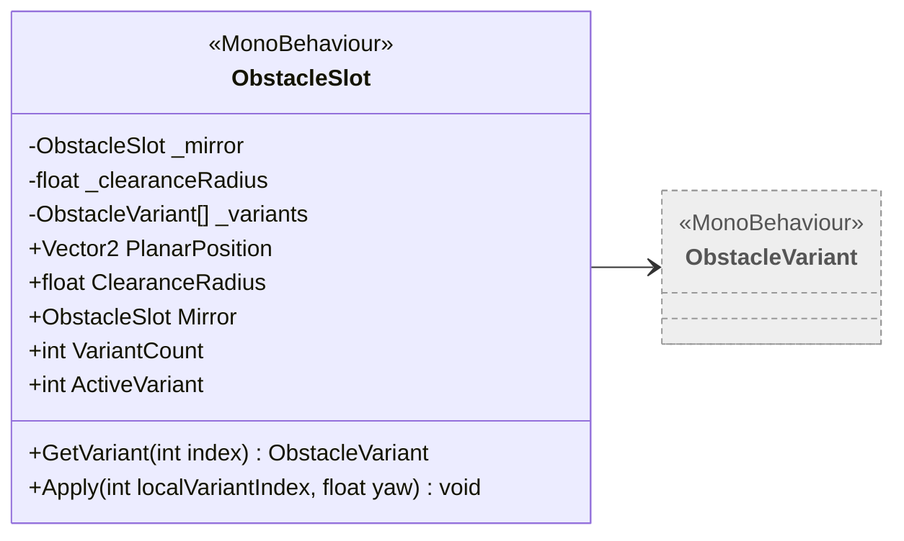

# ObstacleSlot

> A scene-placed spot that may hold one obstacle per round. All its variants are pre-instantiated children, inactive by default; `Apply` enables at most one and sets its yaw. Positions are never changed by code.

**Módulo:** [[Modulo Zones|Zones]] · **Namespace:** `AlienFarms.Zones` · **Archivo:** `Assets/Scripts/Zones/ObstacleSlot.cs`

## Hereda / implementa
`MonoBehaviour`

## Diagrama

## Usa
[[ObstacleVariant]]

## Usado por
[[ObstacleField]]
