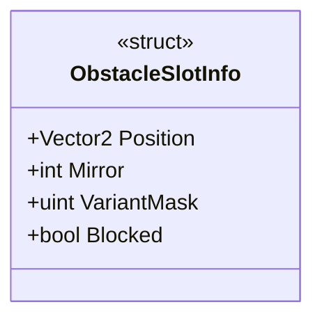

# ObstacleSlotInfo

> Planner input for one obstacle slot. Plain value type, rebuilt in place every round.

**Módulo:** [[Modulo Zones|Zones]] · **Namespace:** `AlienFarms.Zones` · **Archivo:** `Assets/Scripts/Zones/ObstacleSlotInfo.cs`

## Diagrama

## Usado por
[[ObstacleField]], [[ObstacleLayoutPlanner]]
