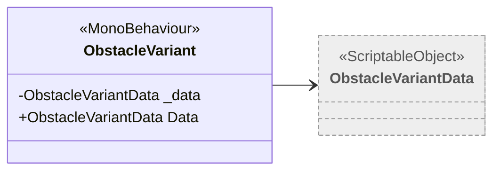

# ObstacleVariant

> Root of one obstacle variant prefab (pivot at ground level). Pre-instantiated, inactive, under an `ObstacleSlot`; the slot only toggles it and sets its yaw. Its geometry lives on the Environment layer.

**Módulo:** [[Modulo Zones|Zones]] · **Namespace:** `AlienFarms.Zones` · **Archivo:** `Assets/Scripts/Zones/ObstacleVariant.cs`

## Hereda / implementa
`MonoBehaviour`

## Diagrama

## Usa
[[LayerNames]], [[ObstacleVariantData]]

## Usado por
[[ObstacleField]], [[ObstacleSlot]]
