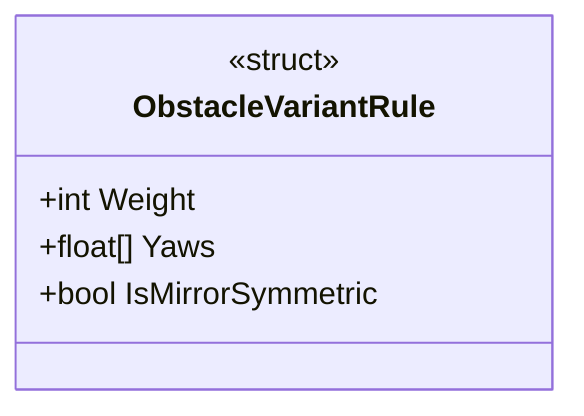

# ObstacleVariantRule

> Planner rule for one entry of the variant table: relative weight and allowed yaws (degrees).

**Módulo:** [[Modulo Zones|Zones]] · **Namespace:** `AlienFarms.Zones` · **Archivo:** `Assets/Scripts/Zones/ObstacleVariantRule.cs`

## Diagrama

## Usado por
[[ObstacleField]], [[ObstacleLayoutPlanner]]
