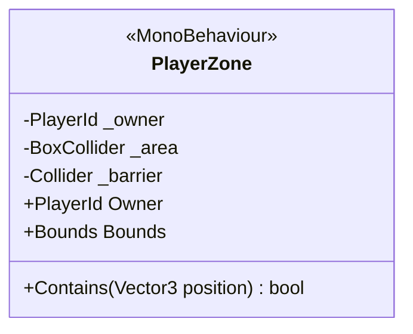

# PlayerZone

> A player's pen. Its BoxCollider defines the capture area: an animal that lands inside counts for the owner while it stays captured. A child barrier (layer ZoneBarrier) keeps captured animals in; both players walk through it.

**Módulo:** [[Modulo Zones|Zones]] · **Namespace:** `AlienFarms.Zones` · **Archivo:** `Assets/Scripts/Zones/PlayerZone.cs`

## Hereda / implementa
`MonoBehaviour`

## Diagrama

## Usa
[[LayerNames]], [[PlayerId]], [[ZoneBounds]]

## Usado por
[[PlayerZoneRegistry]]
