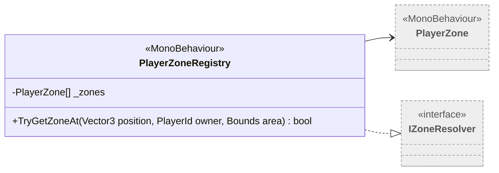

# PlayerZoneRegistry

> Scene registry of the player pens (lives on the 'Zones' root). Animals ask it, through `IZoneResolver`, which pen they landed in.

**Módulo:** [[Modulo Zones|Zones]] · **Namespace:** `AlienFarms.Zones` · **Archivo:** `Assets/Scripts/Zones/PlayerZoneRegistry.cs`

## Hereda / implementa
`MonoBehaviour`, [[IZoneResolver]]

## Diagrama

## Usa
[[IZoneResolver]], [[PlayerId]], [[PlayerZone]]

## Usado por
[[AnimalSpawner]]
