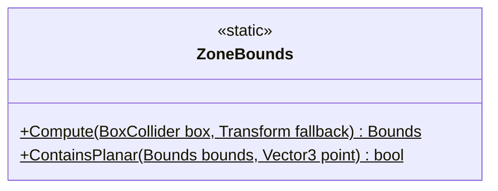

# ZoneBounds

> Shared helpers to read zone areas from BoxColliders and test planar containment.

**Módulo:** [[Modulo Zones|Zones]] · **Namespace:** `AlienFarms.Zones` · **Archivo:** `Assets/Scripts/Zones/ZoneBounds.cs`

## Diagrama

## Usado por
[[AnimalZone]], [[PlayerZone]]
