# Eventos globales (GameEvents)

Comunicación desacoplada entre sistemas (`AlienFarms.Core.GameEvents`). Publica = llama a `GameEvents.RaiseX`; escucha = se suscribe a `GameEvents.OnX`.

## Mapa publicador → suscriptor

```mermaid
flowchart LR
  NetworkPlayer -- OnPlayerJoined --> JoinPromptView
  NetworkPlayer -- OnPlayerJoined --> PlayerMenuRouter
  NetworkPlayerRoster -- OnPlayerJoined --> JoinPromptView
  NetworkPlayerRoster -- OnPlayerJoined --> PlayerMenuRouter
  PlayerJoinCoordinator -- OnPlayerJoined --> JoinPromptView
  PlayerJoinCoordinator -- OnPlayerJoined --> PlayerMenuRouter
  NetworkPlayer -- OnPlayerLeft --> JoinPromptView
  NetworkPlayer -- OnPlayerLeft --> PauseController
  NetworkPlayer -- OnPlayerLeft --> PlayerHudThemeView
  NetworkPlayerRoster -- OnPlayerLeft --> JoinPromptView
  NetworkPlayerRoster -- OnPlayerLeft --> PauseController
  NetworkPlayerRoster -- OnPlayerLeft --> PlayerHudThemeView
  PlayerJoinCoordinator -- OnPlayerLeft --> JoinPromptView
  PlayerJoinCoordinator -- OnPlayerLeft --> PauseController
  PlayerJoinCoordinator -- OnPlayerLeft --> PlayerHudThemeView
  PlayerPauseInput -- OnPauseRequested --> PauseController
  PlayerPauseInput -- OnPauseHoldProgress --> PauseHoldIndicatorView
  PauseController -- OnGamePaused --> MatchStatusSfxPlayer
  PauseController -- OnGamePaused --> PauseHoldIndicatorView
  PauseController -- OnGamePaused --> PauseMenuView
  PauseController -- OnGameResumed --> PauseHoldIndicatorView
  PauseController -- OnGameResumed --> PauseMenuView
  PauseController -- OnPauseMenuResumed --> MatchStatusSfxPlayer
  PlayerMenuInput -- OnMenuCancelPressed --> PauseController
  MenuFlowController -- OnCharacterPickConfirmed --> CharacterSelectSfxPlayer
  MenuFlowController -- OnCharacterPickReleased --> CharacterSelectSfxPlayer
  PlayerMenuInput -- OnPlayerDeviceLost --> PauseController
  PlayerMenuInput -- OnPlayerDeviceLost --> ResultsMenuController
  PlayerMenuInput -- OnPlayerDeviceRegained --> PauseController
  PlayerMenuInput -- OnPlayerDeviceRegained --> ResultsMenuController
  NetworkPlayer -- OnPlayerCharacterAssigned --> ConnectionStatusView
  NetworkPlayer -- OnPlayerCharacterAssigned --> MatchResultsView
  NetworkPlayer -- OnPlayerCharacterAssigned --> PauseMenuView
  NetworkPlayer -- OnPlayerCharacterAssigned --> PlayerHudThemeView
  NetworkPlayerRoster -- OnPlayerCharacterAssigned --> ConnectionStatusView
  NetworkPlayerRoster -- OnPlayerCharacterAssigned --> MatchResultsView
  NetworkPlayerRoster -- OnPlayerCharacterAssigned --> PauseMenuView
  NetworkPlayerRoster -- OnPlayerCharacterAssigned --> PlayerHudThemeView
  PlayerJoinCoordinator -- OnPlayerCharacterAssigned --> ConnectionStatusView
  PlayerJoinCoordinator -- OnPlayerCharacterAssigned --> MatchResultsView
  PlayerJoinCoordinator -- OnPlayerCharacterAssigned --> PauseMenuView
  PlayerJoinCoordinator -- OnPlayerCharacterAssigned --> PlayerHudThemeView
  Animal -- OnAnimalGrabbed --> AnimalSfxPlayer
  NetworkAnimal -- OnAnimalGrabbed --> AnimalSfxPlayer
  Animal -- OnAnimalDropped --> AnimalSfxPlayer
  Animal -- OnAnimalDropped --> NetworkAnimal
  NetworkAnimal -- OnAnimalDropped --> AnimalSfxPlayer
  NetworkAnimal -- OnAnimalDropped --> NetworkAnimal
  Animal -- OnAnimalCaptured --> MatchManager
  NetworkAnimal -- OnAnimalCaptured --> MatchManager
  Animal -- OnAnimalLeftZone --> MatchManager
  NetworkAnimal -- OnAnimalLeftZone --> MatchManager
  MatchManager -- OnScoreChanged --> NetworkMatchState
  MatchManager -- OnScoreChanged --> ScoreView
  NetworkMatchState -- OnScoreChanged --> NetworkMatchState
  NetworkMatchState -- OnScoreChanged --> ScoreView
  MatchStateMachine -- OnMatchPhaseChanged --> BombSpawner
  MatchStateMachine -- OnMatchPhaseChanged --> CountdownView
  MatchStateMachine -- OnMatchPhaseChanged --> MatchResultsView
  MatchStateMachine -- OnMatchPhaseChanged --> MatchStatusSfxPlayer
  MatchStateMachine -- OnMatchPhaseChanged --> NetworkMatchState
  MatchStateMachine -- OnMatchPhaseChanged --> NetworkPlayer
  MatchStateMachine -- OnMatchPhaseChanged --> OnlineMatchStatsRecorder
  MatchStateMachine -- OnMatchPhaseChanged --> PauseController
  MatchStateMachine -- OnMatchPhaseChanged --> PauseHoldIndicatorView
  MatchStateMachine -- OnMatchPhaseChanged --> ResultsMenuController
  NetworkMatchState -- OnMatchPhaseChanged --> BombSpawner
  NetworkMatchState -- OnMatchPhaseChanged --> CountdownView
  NetworkMatchState -- OnMatchPhaseChanged --> MatchResultsView
  NetworkMatchState -- OnMatchPhaseChanged --> MatchStatusSfxPlayer
  NetworkMatchState -- OnMatchPhaseChanged --> NetworkMatchState
  NetworkMatchState -- OnMatchPhaseChanged --> NetworkPlayer
  NetworkMatchState -- OnMatchPhaseChanged --> OnlineMatchStatsRecorder
  NetworkMatchState -- OnMatchPhaseChanged --> PauseController
  NetworkMatchState -- OnMatchPhaseChanged --> PauseHoldIndicatorView
  NetworkMatchState -- OnMatchPhaseChanged --> ResultsMenuController
  CountdownState -- OnCountdownTick --> CountdownView
  NetworkMatchState -- OnCountdownTick --> CountdownView
  CountdownState -- OnCountdownFinished --> CountdownView
  NetworkMatchState -- OnCountdownFinished --> CountdownView
  MatchManager -- OnMatchTimeChanged --> MatchTimerView
  MatchManager -- OnMatchTimeChanged --> NetworkMatchState
  NetworkMatchState -- OnMatchTimeChanged --> MatchTimerView
  NetworkMatchState -- OnMatchTimeChanged --> NetworkMatchState
  PlayingState -- OnMatchTimeChanged --> MatchTimerView
  PlayingState -- OnMatchTimeChanged --> NetworkMatchState
  NetworkMatchState -- OnMatchEnded --> MatchResultsView
  NetworkMatchState -- OnMatchEnded --> OnlineMatchStatsRecorder
  NetworkMatchState -- OnMatchEnded --> ResultsMenuController
  ResultsState -- OnMatchEnded --> MatchResultsView
  ResultsState -- OnMatchEnded --> OnlineMatchStatsRecorder
  ResultsState -- OnMatchEnded --> ResultsMenuController
  Bomb -- OnBombSpawned --> BombSfxPlayer
  NetworkBomb -- OnBombSpawned --> BombSfxPlayer
  Bomb -- OnBombGrabbed --> BombSfxPlayer
  NetworkBomb -- OnBombGrabbed --> BombSfxPlayer
  Bomb -- OnBombArmed --> BombSfxPlayer
  NetworkBomb -- OnBombArmed --> BombSfxPlayer
  Bomb -- OnBombDespawned --> BombSfxPlayer
  NetworkBomb -- OnBombDespawned --> BombSfxPlayer
  Bomb -- OnBombDetonated --> BombBlastVfxPlayer
  Bomb -- OnBombDetonated --> BombSfxPlayer
  NetworkBomb -- OnBombDetonated --> BombBlastVfxPlayer
  NetworkBomb -- OnBombDetonated --> BombSfxPlayer
  NetworkBomb -- OnPlayerStunned --> BombSfxPlayer
  NetworkBomb -- OnPlayerStunned --> NetworkBomb
  PlayerStunReceiver -- OnPlayerStunned --> BombSfxPlayer
  PlayerStunReceiver -- OnPlayerStunned --> NetworkBomb
  MatchManager -- OnPenInventoryChanged --> NetworkPenLedger
  MatchManager -- OnPenInventoryChanged --> PenInventoryView
  NetworkPenLedger -- OnPenInventoryChanged --> NetworkPenLedger
  NetworkPenLedger -- OnPenInventoryChanged --> PenInventoryView
  NetworkSeatPresence -- OnPlayerConnectionChanged --> ConnectionStatusView
  NetworkSeatPresence -- OnPlayerConnectionChanged --> MatchStatusSfxPlayer
  NetworkSeatPresence -- OnPlayerConnectionChanged --> ResultsMenuController
```

## OnPlayerJoined
`Action<PlayerId>`

- **Publica:** [[NetworkPlayer]], [[NetworkPlayerRoster]], [[PlayerJoinCoordinator]]
- **Escucha:** [[JoinPromptView]], [[PlayerMenuRouter]]

## OnPlayerLeft
`Action<PlayerId>`

- **Publica:** [[NetworkPlayer]], [[NetworkPlayerRoster]], [[PlayerJoinCoordinator]]
- **Escucha:** [[JoinPromptView]], [[PauseController]], [[PlayerHudThemeView]]

## OnPauseRequested
`Action<PlayerId>`

> A player held Pause long enough to request the pause menu.

- **Publica:** [[PlayerPauseInput]]
- **Escucha:** [[PauseController]]

## OnPauseHoldProgress
`Action<PlayerId, float>`

> Hold-to-pause progress of the given player changed (0..1). Raised only while the value changes (holding, or once with 0 on release).

- **Publica:** [[PlayerPauseInput]]
- **Escucha:** [[PauseHoldIndicatorView]]

## OnGamePaused
`Action<PlayerId>`

> The game was paused; payload: the player who owns the pause menu.

- **Publica:** [[PauseController]]
- **Escucha:** [[MatchStatusSfxPlayer]], [[PauseHoldIndicatorView]], [[PauseMenuView]]

## OnGameResumed
`Action<PlayerId>`

> The game was resumed; payload: the player who owned the pause menu.

- **Publica:** [[PauseController]]
- **Escucha:** [[PauseHoldIndicatorView]], [[PauseMenuView]]

## OnPauseMenuResumed
`Action<PlayerId>`

> The pause owner chose to keep playing via Resume or Cancel. Raised after OnGameResumed.

- **Publica:** [[PauseController]]
- **Escucha:** [[MatchStatusSfxPlayer]]

## OnMenuCancelPressed
`Action<PlayerId>`

> A player pressed Cancel while navigating a menu.

- **Publica:** [[PlayerMenuInput]]
- **Escucha:** [[PauseController]]

## OnCharacterPickConfirmed
`Action<PlayerId>`

> Local character select: the player locked its hovered character.

- **Publica:** [[MenuFlowController]]
- **Escucha:** [[CharacterSelectSfxPlayer]]

## OnCharacterPickReleased
`Action<PlayerId>`

> Local character select: the player released its pick using Cancel.

- **Publica:** [[MenuFlowController]]
- **Escucha:** [[CharacterSelectSfxPlayer]]

## OnPlayerDeviceLost
`Action<PlayerId>`

> A player's PlayerInput lost one of its paired devices (e.g. gamepad unplugged).

- **Publica:** [[PlayerMenuInput]]
- **Escucha:** [[PauseController]], [[ResultsMenuController]]

## OnPlayerDeviceRegained
`Action<PlayerId>`

> A player's PlayerInput regained a previously lost device.

- **Publica:** [[PlayerMenuInput]]
- **Escucha:** [[PauseController]], [[ResultsMenuController]]

## OnPlayerCharacterAssigned
`Action<PlayerId, CharacterDefinition>`

> A joined player was assigned a character. Raised right before `OnPlayerJoined`.

- **Publica:** [[NetworkPlayer]], [[NetworkPlayerRoster]], [[PlayerJoinCoordinator]]
- **Escucha:** [[ConnectionStatusView]], [[MatchResultsView]], [[PauseMenuView]], [[PlayerHudThemeView]]

## OnAnimalGrabbed
`Action<PlayerId, Animal>`

> A player picked up an animal.

- **Publica:** [[Animal]], [[NetworkAnimal]]
- **Escucha:** [[AnimalSfxPlayer]]

## OnAnimalDropped
`Action<PlayerId, Animal, DropReason>`

> An animal left the hands of the given player (the previous holder). The animal is Airborne at this point, including `DropReason.Thrown` launches; where it lands decides capture.

- **Publica:** [[Animal]], [[NetworkAnimal]]
- **Escucha:** [[AnimalSfxPlayer]], [[NetworkAnimal]]

## OnAnimalCaptured
`Action<PlayerId, Animal>`

> An animal settled inside the given player's zone (the zone owner), whoever released it. It counts for that player until `OnAnimalLeftZone` is raised for it.

- **Publica:** [[Animal]], [[NetworkAnimal]]
- **Escucha:** [[MatchManager]]

## OnAnimalLeftZone
`Action<PlayerId, Animal>`

> A captured animal left the given player's zone (grabbed by anyone or despawned).

- **Publica:** [[Animal]], [[NetworkAnimal]]
- **Escucha:** [[MatchManager]]

## OnScoreChanged
`Action<PlayerId, int>`

> The given player's score changed to the new total (sum of the points of the animals in its zone).

- **Publica:** [[MatchManager]], [[NetworkMatchState]]
- **Escucha:** [[NetworkMatchState]], [[ScoreView]]

## OnMatchPhaseChanged
`Action<MatchPhase, MatchPhase>`

> Global: the match moved from the first phase (previous) to the second (current).

- **Publica:** [[MatchStateMachine]], [[NetworkMatchState]]
- **Escucha:** [[BombSpawner]], [[CountdownView]], [[MatchResultsView]], [[MatchStatusSfxPlayer]], [[NetworkMatchState]], [[NetworkPlayer]], [[OnlineMatchStatsRecorder]], [[PauseController]], [[PauseHoldIndicatorView]], [[ResultsMenuController]]

## OnCountdownTick
`Action<int>`

> Global: whole seconds left in the pre-round countdown.

- **Publica:** [[CountdownState]], [[NetworkMatchState]]
- **Escucha:** [[CountdownView]]

## OnCountdownFinished
`Action<float>`

> Global: the countdown reached zero; play starts. Payload: how long to show the 'GO' message (s).

- **Publica:** [[CountdownState]], [[NetworkMatchState]]
- **Escucha:** [[CountdownView]]

## OnMatchTimeChanged
`Action<int>`

> Global: whole seconds left in the round. Raised only when the displayed second changes (1 Hz).

- **Publica:** [[MatchManager]], [[NetworkMatchState]], [[PlayingState]]
- **Escucha:** [[MatchTimerView]], [[NetworkMatchState]]

## OnMatchEnded
`Action<MatchResult>`

> Global: the round ended with this result (contains both players' scores).

- **Publica:** [[NetworkMatchState]], [[ResultsState]]
- **Escucha:** [[MatchResultsView]], [[OnlineMatchStatsRecorder]], [[ResultsMenuController]]

## OnBombSpawned
`Action<Bomb>`

> Global: a bomb appeared (inert) in the Animal Zone.

- **Publica:** [[Bomb]], [[NetworkBomb]]
- **Escucha:** [[BombSfxPlayer]]

## OnBombGrabbed
`Action<PlayerId, Bomb>`

> A player picked up a bomb.

- **Publica:** [[Bomb]], [[NetworkBomb]]
- **Escucha:** [[BombSfxPlayer]]

## OnBombArmed
`Action<PlayerId, Bomb>`

> A player threw a bomb: it is armed (fuse lit) until it detonates or leaves play.

- **Publica:** [[Bomb]], [[NetworkBomb]]
- **Escucha:** [[BombSfxPlayer]]

## OnBombDespawned
`Action<Bomb>`

> Global: a bomb left play (detonated, fell off the map or the round ended). Raised after `OnBombDetonated` when it exploded.

- **Publica:** [[Bomb]], [[NetworkBomb]]
- **Escucha:** [[BombSfxPlayer]]

## OnBombDetonated
`Action<PlayerId, Vector3, float>`

> A thrown bomb exploded. Payload: thrower (the player who threw it), blast center and blast radius (m).

- **Publica:** [[Bomb]], [[NetworkBomb]]
- **Escucha:** [[BombBlastVfxPlayer]], [[BombSfxPlayer]]

## OnPlayerStunned
`Action<PlayerId, PlayerId, float>`

> A player was stunned by a blast. Payload: victim, source (the thrower) and stun duration (s). Tackle stuns do not raise it.

- **Publica:** [[NetworkBomb]], [[PlayerStunReceiver]]
- **Escucha:** [[BombSfxPlayer]], [[NetworkBomb]]

## OnPenInventoryChanged
`Action<PlayerId, int, int>`

> The given player's pen now holds count animals of the type at animalTypeIndex (index in the spawn settings' entries).

- **Publica:** [[MatchManager]], [[NetworkPenLedger]]
- **Escucha:** [[NetworkPenLedger]], [[PenInventoryView]]

## OnPlayerConnectionChanged
`Action<PlayerId, PlayerConnectionStatus, float, bool>`

> Online: the given player's seat presence changed. Payload: player, new status, and the reconnection grace left (s) while `PlayerConnectionStatus.Reconnecting` (0 otherwise), followed by whether the seat is local.

- **Publica:** [[NetworkSeatPresence]]
- **Escucha:** [[ConnectionStatusView]], [[MatchStatusSfxPlayer]], [[ResultsMenuController]]

## OnTackleResolved
`Action<PlayerId, PlayerId, bool>`

> A tackle claim was resolved. Payload: attacker, victim and whether the tackle was accepted.

- **Publica:** —
- **Escucha:** —
