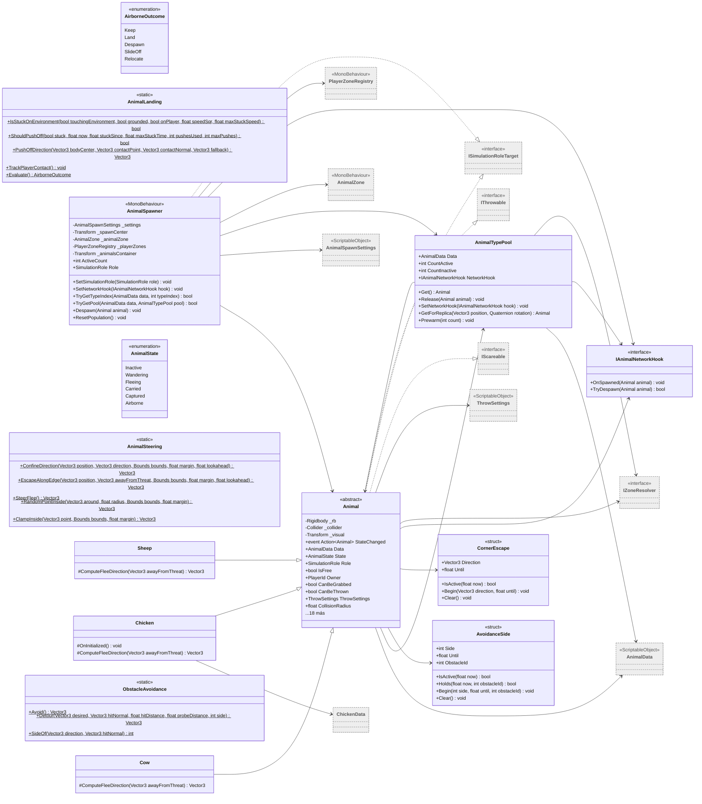

# Módulo Animals

Carpeta `Assets/Scripts/Animals/` · 14 tipos. Las cajas punteadas son tipos de otros módulos.

Leyenda: `--|>` hereda · `..|>` implementa · `-->` tiene un campo/propiedad de ese tipo. Se muestran campos `[SerializeField]` y la API pública.

## Diagrama de clases

## Tipos

| Tipo | Clase | Descripción |
|---|---|---|
| [[AirborneOutcome]] | enumeration | What an airborne animal does this physics step (see `AnimalLanding.Evaluate`). |
| [[Animal]] | abstract | Pooled, Rigidbody-driven animal that wanders inside the Animal Zone, flees from nearby players and can be carried and thrown by a player. De… |
| [[AnimalLanding]] | static | Pure rule that decides what an airborne animal does this physics step. |
| [[AnimalSpawner]] | MonoBehaviour | Scene composition root for animals: owns one pool per type, spawns the initial population around a scene-placed center and refills it over t… |
| [[AnimalState]] | enumeration | High-level behaviour state of an `Animal`. |
| [[AnimalSteering]] | static | Pure planar (X/Z) steering helpers that keep animals inside a `Bounds` shrunk by a margin (the "inner rectangle"). Stateless, allocation-fre… |
| [[AnimalTypePool]] | class | Object pool for a single `AnimalData` type. Instances are created inactive under a container; activation is done by `Animal.Spawn` after pos… |
| [[AvoidanceSide]] | struct | Hysteresis state for `ObstacleAvoidance.Avoid`: once an animal picks a side to go around an obstacle, it keeps that side for that same obsta… |
| [[Chicken]] | class | Fast, light animal that zigzags while fleeing. |
| [[CornerEscape]] | struct | Hysteresis state for `AnimalSteering.SteerFlee`: once a cornered animal picks an edge to run along, it keeps that axis direction at least un… |
| [[Cow]] | class | Heaviest animal: slow to react and to flee (straight line), worth the most points. Its carry and throw penalties live in its `AlienFarms.Dat… |
| [[IAnimalNetworkHook]] | interface | Lets a network layer follow the authority's animal lifecycle. Without a hook, animals go straight back to their pool on despawn (local mode)… |
| [[ObstacleAvoidance]] | static | Pure planar obstacle avoidance: given the desired direction and a probe hit in front of the animal, slides along the obstacle tangent and ad… |
| [[Sheep]] | class | Heavy, slow animal that flees in a straight line. |

## Depende de
[[Modulo Core|Core]] (15), [[Modulo Data|Data]] (7), [[Modulo Items|Items]] (2), [[Modulo Zones|Zones]] (2)