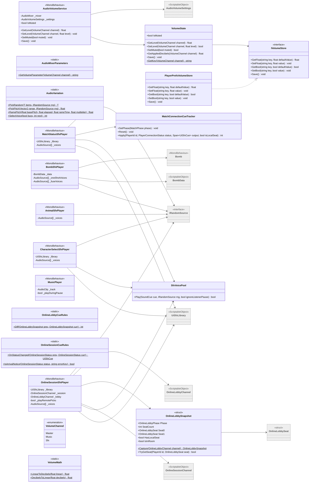

# Módulo Audio

Carpeta `Assets/Scripts/Audio/` · 19 tipos. Las cajas punteadas son tipos de otros módulos.

Leyenda: `--|>` hereda · `..|>` implementa · `-->` tiene un campo/propiedad de ese tipo. Se muestran campos `[SerializeField]` y la API pública.

## Diagrama de clases

## Tipos

| Tipo | Clase | Descripción |
|---|---|---|
| [[AnimalSfxPlayer]] | MonoBehaviour | Plays animal voices: the grab voice when any player picks an animal up (stealing included, since the thief grabs it again after the tackle k… |
| [[AudioMixerParameters]] | static | Names of the exposed AudioMixer parameters (volume of each group, in dB). The only place these strings live: they must match the exposed par… |
| [[AudioVariation]] | static | Pure helpers that add variety to repeated sounds (random clip and pitch, voice selection). |
| [[AudioVolumeService]] | MonoBehaviour | Per-scene volume service: loads the saved levels (PlayerPrefs) and drives the exposed volume parameters of the AudioMixer. Not a singleton: … |
| [[BombSfxPlayer]] | MonoBehaviour | Plays the stun bomb sounds: spawn pop, grab, a looped fuse per armed bomb (its pitch rises while it flies and it is cut when that bomb deton… |
| [[CharacterSelectSfxPlayer]] | MonoBehaviour |  |
| [[IVolumeStore]] | interface | Key/value persistence for volume preferences (PlayerPrefs at runtime, a fake in tests). |
| [[MatchConnectionCueTracker]] | class |  |
| [[MatchStatusSfxPlayer]] | MonoBehaviour |  |
| [[MusicPlayer]] | MonoBehaviour | Loops a scene's music track on a 2D AudioSource (route its output to the Music mixer group). Optionally keeps playing while the game is paus… |
| [[OnlineLobbyCueRules]] | static |  |
| [[OnlineLobbySnapshot]] | struct |  |
| [[OnlineSessionCueRules]] | static |  |
| [[OnlineSessionSfxPlayer]] | MonoBehaviour |  |
| [[PlayerPrefsVolumeStore]] | class | `IVolumeStore` backed by `PlayerPrefs` (bools stored as 0/1 ints). |
| [[SfxVoicePool]] | class |  |
| [[VolumeChannel]] | enumeration | Volume channels exposed by the AlienFarmsMixer. Values index per-channel arrays. |
| [[VolumeMath]] | static | Conversions between linear slider volume (0..1) and AudioMixer attenuation (dB). |
| [[VolumeState]] | class | Plain C# volume model: linear level per `VolumeChannel` plus a master mute, loaded from and written through an `IVolumeStore`. Missing keys … |

## Depende de
[[Modulo Animals|Animals]] (1), [[Modulo Core|Core]] (23), [[Modulo Data|Data]] (19), [[Modulo Items|Items]] (1), [[Modulo Match|Match]] (1), [[Modulo Networking|Networking]] (3), [[Modulo Utilities|Utilities]] (12)