# Módulo Core

Carpeta `Assets/Scripts/Core/` · 19 tipos. Las cajas punteadas son tipos de otros módulos.

Leyenda: `--|>` hereda · `..|>` implementa · `-->` tiene un campo/propiedad de ese tipo. Se muestran campos `[SerializeField]` y la API pública.

## Diagrama de clases

```mermaid
classDiagram
  direction LR
  class DropReason {
    <<enumeration>>
    Released
    Stolen
    Forced
    Thrown
    Stunned
  }
  class GameEvents {
    <<static>>
    +event Action~PlayerId~ OnPlayerJoined$
    +event Action~PlayerId~ OnPlayerLeft$
    +event Action~PlayerId~ OnPauseRequested$
    +event Action~PlayerId, float~ OnPauseHoldProgress$
    +event Action~PlayerId~ OnGamePaused$
    +event Action~PlayerId~ OnGameResumed$
    +event Action~PlayerId~ OnMenuCancelPressed$
    +event Action~PlayerId~ OnPlayerDeviceLost$
    +event Action~PlayerId~ OnPlayerDeviceRegained$
    +event Action~PlayerId, CharacterDefinition~ OnPlayerCharacterAssigned$
    +event Action~PlayerId, Animal~ OnAnimalGrabbed$
    +event Action~PlayerId, Animal, DropReason~ OnAnimalDropped$
    +event Action~PlayerId, Animal~ OnAnimalCaptured$
    ...45 más
  }
  class GameMode {
    <<enumeration>>
    Local
    Online
  }
  class IGrabbable {
    <<interface>>
    +bool CanBeGrabbed
    +PlayerId Holder
    +Vector3 Position
    +float CarrySpeedMultiplier
    +TryGrab(PlayerId holder, Transform holdPoint) bool
    +Release(Vector3 position, Vector3 velocity, DropReason reason) void
  }
  class IPlayerCommandSource {
    <<interface>>
    +Vector2 Move
    +Vector2 Look
    +bool IsLookPointerDelta
    +bool IsSprintHeld
    +bool IsGrabHeld
    +bool IsAimHeld
    -event Action GrabStarted
    -event Action GrabCanceled
  }
  class IScareable {
    <<interface>>
    +Scare(Vector3 threatPosition, float minDuration) void
  }
  class ISimulationRoleTarget {
    <<interface>>
    +SimulationRole Role
    +SetSimulationRole(SimulationRole role) void
  }
  class IStunnable {
    <<interface>>
    +PlayerId Id
    +ReceiveStun(PlayerId source, Vector3 origin, float duration, float knockbackSpeed) void
  }
  class IThrowable {
    <<interface>>
    +bool CanBeThrown
    +ThrowSettings ThrowSettings
    +float ThrowDistanceMultiplier
    +float CollisionRadius
    +float HalfHeight
  }
  class IZoneResolver {
    <<interface>>
    +TryGetZoneAt(Vector3 position, PlayerId owner, Bounds area) bool
  }
  class LayerNames {
    <<static>>
  }
  class MatchPhase {
    <<enumeration>>
    None
    WaitingForPlayers
    Countdown
    Playing
    Results
  }
  class MatchResult {
    <<struct>>
    +PlayerId Winner
    +int Player1Score
    +int Player2Score
    +bool IsDraw
    +GetScore(PlayerId id) int
  }
  class PlayerId {
    <<enumeration>>
    None
    Player1
    Player2
  }
  class PlayerIdExtensions {
    <<static>>
    +Other(PlayerId id)$ PlayerId
  }
  class PlayerIdentity {
    <<MonoBehaviour>>
    -PlayerId _id
    +PlayerId Id
    +Initialize(PlayerId id) void
  }
  class SceneFlow {
    <<static>>
    +LoadMainMenu()$ bool
    +LoadGameplay()$ bool
  }
  class SceneNames {
    <<static>>
  }
  class SimulationRole {
    <<enumeration>>
    Authority
    Replica
  }
  class ThrowSettings:::external
  <<ScriptableObject>> ThrowSettings
  IThrowable --> ThrowSettings
  IThrowable ..|> IGrabbable
  classDef external fill:#eee,stroke:#999,stroke-dasharray: 4 3,color:#555
```

## Tipos

| Tipo | Clase | Descripción |
|---|---|---|
| [[DropReason]] | enumeration | Why a carried `IGrabbable` left its holder. |
| [[GameEvents]] | static | Global static events for decoupled communication between systems. Every per-player payload carries the `PlayerId` involved. Exception: match… |
| [[GameMode]] | enumeration | How the gameplay scene is driven: local split-screen or online. |
| [[IGrabbable]] | interface | Something a player can pick up, carry at a hold point and drop. |
| [[IPlayerCommandSource]] | interface | Everything the player's gameplay components read from input. Implemented locally by the PlayerInputHandler and, online, by a network-fed sou… |
| [[IScareable]] | interface | Something that runs away from a sudden threat (e.g. a blast). Only free, grounded animals react. |
| [[ISimulationRoleTarget]] | interface | A component whose simulation can be switched between Authority (default) and Replica. |
| [[IStunnable]] | interface | Something a blast can stun (a player): drops what it carries, gets knocked back and loses control. |
| [[IThrowable]] | interface | A grabbable that can be launched on a ballistic arc while carried. The launch itself goes through `IGrabbable.Release` with `DropReason.Thro… |
| [[IZoneResolver]] | interface | Answers which player zone (if any) contains a world position. |
| [[LayerNames]] | static | Physics layer names as configured in Tags and Layers. Resolve to indices once, never per frame. |
| [[MatchPhase]] | enumeration | Phases of a match, driven by the MatchManager state machine. |
| [[MatchResult]] | struct | Final outcome of a round. `Winner` is `PlayerId.None` on a draw. |
| [[PlayerId]] | enumeration | Identifies one of the two local players. |
| [[PlayerIdExtensions]] | static | Helpers for the two-player `PlayerId`. |
| [[PlayerIdentity]] | MonoBehaviour | Holds which local player owns this GameObject hierarchy. |
| [[SceneFlow]] | static | Stateless scene transitions. Every load restores time and audio first, so leaving a paused scene never carries `Time.timeScale` = 0 or a pau… |
| [[SceneNames]] | static | Scene names as listed in Build Settings (MainMenu = 0, Prototype = 1). |
| [[SimulationRole]] | enumeration | Who runs a simulated component. Authority runs the gameplay logic (local mode and the online server); Replica only shows state applied from … |

## Depende de
[[Modulo Animals|Animals]] (2), [[Modulo Data|Data]] (2), [[Modulo Items|Items]] (2)