# Módulo Core

Carpeta `Assets/Scripts/Core/` · 36 tipos. Las cajas punteadas son tipos de otros módulos.

Leyenda: `--|>` hereda · `..|>` implementa · `-->` tiene un campo/propiedad de ese tipo. Se muestran campos `[SerializeField]` y la API pública.

## Diagrama de clases

```mermaid
classDiagram
  direction LR
  class DisplayNameSanitizer {
    <<static>>
    +FitToPayload(string name)$ string
    +Fit(string name, int budget, bool inUtf8Bytes)$ string
    +Sanitize(string name)$ string
    +IsClean(string name)$ bool
  }
  class DropReason {
    <<enumeration>>
    Released
    Stolen
    Forced
    Thrown
    Stunned
  }
  class GameEvents {
    <<static>>
    +event Action~PlayerId~ OnPlayerJoined$
    +event Action~PlayerId~ OnPlayerLeft$
    +event Action~PlayerId~ OnPauseRequested$
    +event Action~PlayerId, float~ OnPauseHoldProgress$
    +event Action~PlayerId~ OnGamePaused$
    +event Action~PlayerId~ OnGameResumed$
    +event Action~PlayerId~ OnPauseMenuResumed$
    +event Action~PlayerId~ OnMenuCancelPressed$
    +event Action~PlayerId~ OnCharacterPickConfirmed$
    +event Action~PlayerId~ OnCharacterPickReleased$
    +event Action~PlayerId~ OnPlayerDeviceLost$
    +event Action~PlayerId~ OnPlayerDeviceRegained$
    +event Action~PlayerId, CharacterDefinition~ OnPlayerCharacterAssigned$
    ...52 más
  }
  class GameMode {
    <<enumeration>>
    Local
    Online
  }
  class GameModeRouter {
    <<MonoBehaviour>>
    -MatchSession _session
    -GameObject _localModeRoot
    -GameObject _onlineModeRoot
    -MatchManager _match
    -PauseController _pause
    -MonoBehaviour _onlineRoster
    -PlayerMenuRouter _menuRouter
    -MonoBehaviour _onlineMenuPlayers
    +GameMode Mode
  }
  class IGrabbable {
    <<interface>>
    +bool CanBeGrabbed
    +PlayerId Holder
    +Vector3 Position
    +float CarrySpeedMultiplier
    +TryGrab(PlayerId holder, Transform holdPoint) bool
    +Release(Vector3 position, Vector3 velocity, DropReason reason) void
  }
  class IPlayerCommandSource {
    <<interface>>
    +Vector2 Move
    +Vector2 Look
    +bool IsLookPointerDelta
    +bool IsSprintHeld
    +bool IsGrabHeld
    +bool IsAimHeld
    -event Action GrabStarted
    -event Action GrabCanceled
  }
  class IScareable {
    <<interface>>
    +Scare(Vector3 threatPosition, float minDuration) void
  }
  class ISimulationRoleTarget {
    <<interface>>
    +SimulationRole Role
    +SetSimulationRole(SimulationRole role) void
  }
  class IStunnable {
    <<interface>>
    +PlayerId Id
    +ReceiveStun(PlayerId source, Vector3 origin, float duration, float knockbackSpeed) void
  }
  class IThrowable {
    <<interface>>
    +bool CanBeThrown
    +ThrowSettings ThrowSettings
    +float ThrowDistanceMultiplier
    +float CollisionRadius
    +float HalfHeight
  }
  class IZoneResolver {
    <<interface>>
    +TryGetZoneAt(Vector3 position, PlayerId owner, Bounds area) bool
  }
  class LayerNames {
    <<static>>
  }
  class MatchEndReason {
    <<enumeration>>
    TimeUp
    Forfeit
  }
  class MatchPhase {
    <<enumeration>>
    None
    WaitingForPlayers
    Countdown
    Playing
    Results
  }
  class MatchResult {
    <<struct>>
    +PlayerId Winner
    +int Player1Score
    +int Player2Score
    +MatchEndReason EndReason
    +bool IsDraw
    +bool IsForfeit
    +PlayerId Forfeiter
    +GetScore(PlayerId id) int
  }
  class OnlineLobbyPhase {
    <<enumeration>>
    Unavailable
    Open
    Starting
  }
  class OnlineLobbySeat {
    <<struct>>
    +PlayerId Id
    +int CharacterIndex
    +string DisplayName
    +bool IsLocal
    +bool IsHost
    +bool HasCharacter
    +Equals(OnlineLobbySeat other) bool
    +Equals(object obj) bool
    +GetHashCode() int
  }
  class OnlineParticipant {
    <<struct>>
    +string UgsPlayerId
    +string DisplayName
    +bool IsHost
    +bool IsLocal
    +Equals(OnlineParticipant other) bool
    +Equals(object obj) bool
    +GetHashCode() int
  }
  class OnlineScreen {
    <<enumeration>>
    Hub
    Join
    Room
    Busy
  }
  class OnlineSessionErrorKeys {
    <<static>>
  }
  class OnlineSessionStatus {
    <<enumeration>>
    SignedOut
    SigningIn
    Ready
    Creating
    Joining
    InSession
    Leaving
  }
  class OnlineSessionStatusRules {
    <<static>>
    +CanTransition(OnlineSessionStatus from, OnlineSessionStatus to)$ bool
    +CanStartSession(OnlineSessionStatus status)$ bool
    +CanLeave(OnlineSessionStatus status)$ bool
    +CanSignIn(OnlineSessionStatus status)$ bool
  }
  class PenInventorySnapshot {
    <<static>>
    +Get(PlayerId playerId, int typeIndex)$ int
  }
  class PlayerConnectionStatus {
    <<enumeration>>
    Connected
    Reconnecting
    Left
    TimedOut
  }
  class PlayerId {
    <<enumeration>>
    None
    Player1
    Player2
  }
  class PlayerIdExtensions {
    <<static>>
    +Other(PlayerId id)$ PlayerId
  }
  class PlayerIdentity {
    <<MonoBehaviour>>
    -PlayerId _id
    +PlayerId Id
    +Initialize(PlayerId id) void
  }
  class PlayerProgressErrorKeys {
    <<static>>
  }
  class PlayerProgressSaveStatus {
    <<enumeration>>
    Idle
    Saving
    Saved
    Failed
  }
  class PlayerProgressStatus {
    <<enumeration>>
    Unavailable
    Loading
    Loaded
    Failed
  }
  class PlayerStatsSummary {
    <<struct>>
    +int MatchesPlayed
    +int Wins
    +int Draws
    +int Losses
    +int AnimalsScored
    +int TacklesLanded
    +Equals(PlayerStatsSummary other) bool
    +Equals(object obj) bool
    +GetHashCode() int
  }
  class SceneFlow {
    <<static>>
    +LoadMainMenu()$ bool
    +LoadGameplay()$ bool
  }
  class SceneNames {
    <<static>>
  }
  class SessionCodeFormat {
    <<static>>
    +TryNormalize(string raw, string normalized)$ bool
  }
  class SimulationRole {
    <<enumeration>>
    Authority
    Replica
  }
  class MatchManager:::external
  <<MonoBehaviour>> MatchManager
  class MatchSession:::external
  <<ScriptableObject>> MatchSession
  class PauseController:::external
  <<MonoBehaviour>> PauseController
  class PlayerMenuRouter:::external
  <<MonoBehaviour>> PlayerMenuRouter
  class ThrowSettings:::external
  <<ScriptableObject>> ThrowSettings
  GameModeRouter --> MatchManager
  GameModeRouter --> MatchSession
  GameModeRouter --> PauseController
  GameModeRouter --> PlayerMenuRouter
  IThrowable --> ThrowSettings
  IThrowable ..|> IGrabbable
  classDef external fill:#eee,stroke:#999,stroke-dasharray: 4 3,color:#555
```

## Tipos

| Tipo | Clase | Descripción |
|---|---|---|
| [[DisplayNameSanitizer]] | static | Cleans a player name that came from another machine (connection payload, session player property) before it is stored or shown: drops contro… |
| [[DropReason]] | enumeration | Why a carried `IGrabbable` left its holder. |
| [[GameEvents]] | static | Global static events for decoupled communication between systems. Every per-player payload carries the `PlayerId` involved. Exception: match… |
| [[GameMode]] | enumeration | How the gameplay scene is driven: local split-screen or online. |
| [[GameModeRouter]] | MonoBehaviour | Composition root of the gameplay scene: reads `MatchSession.Mode` and activates the local or the online mode root, binds the match to that m… |
| [[IGrabbable]] | interface | Something a player can pick up, carry at a hold point and drop. |
| [[IPlayerCommandSource]] | interface | Everything the player's gameplay components read from input. Implemented locally by the PlayerInputHandler and, online, by a network-fed sou… |
| [[IScareable]] | interface | Something that runs away from a sudden threat (e.g. a blast). Only free, grounded animals react. |
| [[ISimulationRoleTarget]] | interface | A component whose simulation can be switched between Authority (default) and Replica. |
| [[IStunnable]] | interface | Something a blast can stun (a player): drops what it carries, gets knocked back and loses control. |
| [[IThrowable]] | interface | A grabbable that can be launched on a ballistic arc while carried. The launch itself goes through `IGrabbable.Release` with `DropReason.Thro… |
| [[IZoneResolver]] | interface | Answers which player zone (if any) contains a world position. |
| [[LayerNames]] | static | Physics layer names as configured in Tags and Layers. Resolve to indices once, never per frame. |
| [[MatchEndReason]] | enumeration | Why a round ended. Replicated as a byte, so values must stay stable. |
| [[MatchPhase]] | enumeration | Phases of a match, driven by the MatchManager state machine. |
| [[MatchResult]] | struct | Final outcome of a round. `Winner` is `PlayerId.None` on a draw. On a `MatchEndReason.Forfeit` the winner is the player who stayed, not the … |
| [[OnlineLobbyPhase]] | enumeration | Phase of the online room (character pick before the match) as published by the network lobby. |
| [[OnlineLobbySeat]] | struct | One player seat of the online room as seen by the menu (published by the network lobby). |
| [[OnlineParticipant]] | struct | One member of the online session as listed by Sessions (host first, then by join order). |
| [[OnlineScreen]] | enumeration | Screens of the online menu panel (resolved by AlienFarms.Menu.OnlineMenuRules.Resolve). |
| [[OnlineSessionErrorKeys]] | static | Localization keys (UI table) of the errors the online session reports through the session channel. The only error strings the online flow pr… |
| [[OnlineSessionStatus]] | enumeration | Lifecycle of the online session as seen by this machine (see `OnlineSessionStatusRules`). |
| [[OnlineSessionStatusRules]] | static | Allowed transitions of `OnlineSessionStatus`. Pure, so the session channel and its tests share them. Any status may fall back to `OnlineSess… |
| [[PenInventorySnapshot]] | static | Last pen inventory count raised per player and animal type, so a view enabled late (or re-enabled) can catch up without waiting for the next… |
| [[PlayerConnectionStatus]] | enumeration | Online presence of a player seat (byte-sized: it is replicated in the seat presence board). |
| [[PlayerId]] | enumeration | Identifies one of the two local players. |
| [[PlayerIdExtensions]] | static | Helpers for the two-player `PlayerId`. |
| [[PlayerIdentity]] | MonoBehaviour | Holds which local player owns this GameObject hierarchy. |
| [[PlayerProgressErrorKeys]] | static | Localization keys (UI table) of the persistent progress (cloud stats) errors the cloud save service reports through the PlayerProgressChanne… |
| [[PlayerProgressSaveStatus]] | enumeration | State of the last write of the player's persistent progress. |
| [[PlayerProgressStatus]] | enumeration | Load state of the player's persistent progress (cloud stats). |
| [[PlayerStatsSummary]] | struct | Lifetime stats of the local player shown on the title screen. |
| [[SceneFlow]] | static | Stateless scene transitions. Every load restores time and audio first, so leaving a paused scene never carries `Time.timeScale` = 0 or a pau… |
| [[SceneNames]] | static | Scene names as listed in Build Settings (MainMenu = 0, Prototype = 1). |
| [[SessionCodeFormat]] | static | Local check of a typed session join code before calling the service: trims, upper-cases and accepts only the characters the service issues. … |
| [[SimulationRole]] | enumeration | Who runs a simulated component. Authority runs the gameplay logic (local mode and the online server); Replica only shows state applied from … |

## Depende de
[[Modulo Animals|Animals]] (2), [[Modulo Data|Data]] (3), [[Modulo Items|Items]] (2), [[Modulo Match|Match]] (2), [[Modulo Networking|Networking]] (1), [[Modulo Player|Player]] (3)