# Módulo Data

Carpeta `Assets/Scripts/Data/` · 23 tipos. Las cajas punteadas son tipos de otros módulos.

Leyenda: `--|>` hereda · `..|>` implementa · `-->` tiene un campo/propiedad de ese tipo. Se muestran campos `[SerializeField]` y la API pública.

## Diagrama de clases

```mermaid
classDiagram
  direction LR
  class AnimalData {
    <<ScriptableObject>>
    -Animal _prefab
    -int _points
    -float _mass
    -float _wanderSpeed
    -float _fleeSpeed
    -float _acceleration
    -float _turnSpeed
    -float _detectionRadius
    -float _fleeExitRadius
    -float _minFleeTime
    -float _detectionInterval
    -float _wanderRadius
    -Vector2 _idleTimeRange
    ...46 más
  }
  class AnimalSpawnEntry {
    <<struct>>
    -AnimalData _data
    -int _weight
    +AnimalData Data
    +int Weight
  }
  class AnimalSpawnSettings {
    <<ScriptableObject>>
    -AnimalSpawnEntry[] _entries
    -int _initialCount
    -int _targetFreePopulation
    -float _respawnInterval
    -int _maxActiveAnimals
    -int _poolHardCap
    -int _prewarmPerType
    -float _spawnRadius
    -float _spawnClearance
    -int _maxPlacementAttempts
    -float _killHeight
    +AnimalSpawnEntry[] Entries
    +int InitialCount
    ...9 más
  }
  class AudioVolumeSettings {
    <<ScriptableObject>>
    -float _defaultMaster
    -float _defaultMusic
    -float _defaultSfx
    -bool _defaultMuted
    +bool DefaultMuted
    +GetDefaultLevel(VolumeChannel channel) float
  }
  class BombData {
    <<ScriptableObject>>
    -Bomb _prefab
    -ThrowSettings _throwSettings
    -float _carrySpeedMultiplier
    -Vector3 _holdOffset
    -float _grabCooldown
    -float _blastRadius
    -float _stunDuration
    -float _knockbackSpeed
    -float _maxArmedTime
    -float _armedBlinkInterval
    -bool _scaresAnimals
    -float _animalScareRadius
    -float _animalScareDuration
    ...31 más
  }
  class BombSpawnSettings {
    <<ScriptableObject>>
    -int _maxActive
    -float _initialDelay
    -Vector2 _respawnIntervalRange
    -float _retryDelay
    -float _edgeMargin
    -float _spawnClearance
    -float _playerClearance
    -int _maxPlacementAttempts
    -float _spawnDropHeight
    -int _poolMaxSize
    -float _killHeight
    +int MaxActive
    +float InitialDelay
    ...9 más
  }
  class CharacterDefinition {
    <<ScriptableObject>>
    -string _displayName
    -Sprite _portrait
    -CharacterTheme _theme
    +string DisplayName
    +Sprite Portrait
    +CharacterTheme Theme
  }
  class CharacterRoster {
    <<ScriptableObject>>
    -CharacterDefinition[] _characters
    +int Count
    +Get(int index) CharacterDefinition
    +IndexOf(CharacterDefinition character) int
  }
  class CharacterTheme {
    <<struct>>
    -Color _primary
    -Color _secondary
    -Color _text
    -Color _accent
    +Color Primary
    +Color Secondary
    +Color Text
    +Color Accent
  }
  class ChickenData {
    -float _zigzagAngle
    -float _zigzagFrequency
    +float ZigzagAngle
    +float ZigzagFrequency
  }
  class MatchSession {
    <<ScriptableObject>>
    +bool IsReady
    +GameMode Mode
    +CharacterDefinition LocalCharacter
    +SetSlot(SessionSlot slot) void
    +SetMode(GameMode mode) void
    +SetLocalCharacter(CharacterDefinition character) void
    +TryGetSlot(PlayerId id, SessionSlot slot) bool
    +Clear() void
  }
  class MatchSettings {
    <<ScriptableObject>>
    -float _matchDuration
    -int _countdownSeconds
    -float _goMessageDuration
    -float _resultsInputDelay
    +float MatchDuration
    +int CountdownSeconds
    +float GoMessageDuration
    +float ResultsInputDelay
  }
  class MenuSettings {
    <<ScriptableObject>>
    -float _navigateStepThreshold
    -float _loadDelayAfterConfirm
    +float NavigateStepThreshold
    +float LoadDelayAfterConfirm
  }
  class NetworkSettings {
    <<ScriptableObject>>
    -int _protocolVersion
    -string _environmentName
    -int _maxPlayers
    -bool _allowSpectator
    -float _reconnectGraceSeconds
    -int _inputRedundancy
    -int _inputBufferTarget
    -float _interpolationDelay
    -float _reconcileThreshold
    -float _visualSmoothingRate
    -bool _predictionDefault
    -float _maxRewindSeconds
    -float _tackleRewindTolerance
    ...17 más
  }
  class ObstacleLayoutSettings {
    <<ScriptableObject>>
    -int _minActive
    -int _maxActive
    -ObstacleWeightEntry[] _variants
    -float _minSpacing
    -float _clearanceProbeHeight
    -float _minEdgeDistance
    -bool _useFixedSeed
    -int _seed
    +int MinActive
    +int MaxActive
    +IReadOnlyList~ObstacleWeightEntry~ Variants
    +float MinSpacing
    +bool MirrorAcrossCenter
    ...5 más
  }
  class ObstacleVariantData {
    <<ScriptableObject>>
    +IReadOnlyList~float~ AllowedYaws
    +int RotationalSymmetry
    +bool IsMirrorSymmetric
  }
  class ObstacleWeightEntry {
    <<struct>>
    -ObstacleVariantData _variant
    -int _weight
    +ObstacleVariantData Variant
    +int Weight
  }
  class PauseSettings {
    <<ScriptableObject>>
    -float _holdDuration
    -float _showProgressAfter
    +float HoldDuration
    +float ShowProgressAfter
  }
  class PlayerSettings {
    <<ScriptableObject>>
    -float _walkSpeed
    -float _sprintSpeed
    -float _acceleration
    -float _deceleration
    -float _rotationSpeed
    -float _mouseSensitivity
    -Vector2 _stickSensitivity
    -bool _invertY
    -float _minPitch
    -float _maxPitch
    -float _defaultPitch
    -float _distance
    -float _collisionRadius
    ...47 más
  }
  class SessionData {
    +Set(SessionSlot slot) bool
    +TryGet(PlayerId id, SessionSlot slot) bool
    +IsComplete(int requiredPlayers) bool
    +Clear() void
  }
  class SessionSlot {
    <<struct>>
    +PlayerId Id
    +string ControlScheme
    +InputDevice[] Devices
    +CharacterDefinition Character
    +bool IsValid
  }
  class SoundCue {
    -AudioClip[] _clips
    -float _volume
    -Vector2 _pitchRange
    +AudioClip[] Clips
    +float Volume
    +Vector2 PitchRange
    +bool HasClips
    +Sanitize() void
  }
  class ThrowSettings {
    <<ScriptableObject>>
    -float _launchSpeed
    -float _baseElevation
    -float _minElevation
    -float _maxElevation
    -float _pitchInfluence
    -float _referenceCameraPitch
    -float _inheritVelocityFactor
    -float _previewMaxTime
    -int _previewStepsPerPoint
    +float LaunchSpeed
    +float BaseElevation
    +float MinElevation
    +float MaxElevation
    ...5 más
  }
  class Animal:::external
  <<abstract>> Animal
  class Bomb:::external
  <<MonoBehaviour>> Bomb
  class BombBlastVfx:::external
  <<MonoBehaviour>> BombBlastVfx
  AnimalData --> Animal
  AnimalData --> ThrowSettings
  AnimalSpawnEntry --> AnimalData
  AnimalSpawnSettings --> AnimalSpawnEntry
  BombData --> Bomb
  BombData --> BombBlastVfx
  BombData --> SoundCue
  BombData --> ThrowSettings
  CharacterDefinition --> CharacterTheme
  CharacterRoster --> CharacterDefinition
  ChickenData --|> AnimalData
  MatchSession --> CharacterDefinition
  MatchSession --> SessionData
  ObstacleLayoutSettings --> ObstacleWeightEntry
  ObstacleWeightEntry --> ObstacleVariantData
  SessionData --> SessionSlot
  SessionSlot --> CharacterDefinition
  classDef external fill:#eee,stroke:#999,stroke-dasharray: 4 3,color:#555
```

## Tipos

| Tipo | Clase | Descripción |
|---|---|---|
| [[AnimalData]] | ScriptableObject | Tuning and prefab for one animal type. |
| [[AnimalSpawnEntry]] | struct | One weighted animal type in `AnimalSpawnSettings`. |
| [[AnimalSpawnSettings]] | ScriptableObject | Population and placement rules for the animal spawner. |
| [[AudioVolumeSettings]] | ScriptableObject | Default volume levels used until the player changes them (saved choices live in PlayerPrefs). |
| [[BombData]] | ScriptableObject | Definition of the stun bomb: prefab, carry/throw tuning, blast, VFX and sound effects. |
| [[BombSpawnSettings]] | ScriptableObject | When and where stun bombs appear in the Animal Zone. |
| [[CharacterDefinition]] | ScriptableObject | A playable character: display name, optional portrait and color theme. The 3D visual is a pre-existing child of the Player prefab matched by… |
| [[CharacterRoster]] | ScriptableObject | Ordered list of selectable characters (character select order). |
| [[CharacterTheme]] | struct | Colors that identify a playable character in the HUD and menus. |
| [[ChickenData]] | class | Animal data for chickens: adds a zigzag while fleeing. |
| [[MatchSession]] | ScriptableObject | Runtime-only ScriptableObject that carries the players' choices (devices, scheme, character) from the MainMenu to the gameplay scene. Nothin… |
| [[MatchSettings]] | ScriptableObject | Timing rules of a match round. |
| [[MenuSettings]] | ScriptableObject | Menu navigation tuning shared by per-player menu input. |
| [[NetworkSettings]] | ScriptableObject | Tuning of the online mode (sessions, input, interpolation, prediction and lag compensation). Primitive fields only, so it lives in the runti… |
| [[ObstacleLayoutSettings]] | ScriptableObject | Rules for the random obstacle layout of the Animal Zone (rolled every new round). |
| [[ObstacleVariantData]] | ScriptableObject | One obstacle type (fence, UFO disc...) and the yaws it may be placed with. |
| [[ObstacleWeightEntry]] | struct | One weighted obstacle variant in `ObstacleLayoutSettings`. |
| [[PauseSettings]] | ScriptableObject | Hold-to-pause tuning. |
| [[PlayerSettings]] | ScriptableObject | Tunable movement, camera, grab, aim and tackle values shared by player characters. |
| [[SessionData]] | class | Plain C# store of the players' pre-match choices, one `SessionSlot` per `PlayerId`. |
| [[SessionSlot]] | struct | What one player chose before the match: its control scheme, the devices it used (both keyboard and mouse for KeyboardMouse) and its characte… |
| [[SoundCue]] | class | One sound effect: candidate clips (one picked at random), volume and random pitch range. |
| [[ThrowSettings]] | ScriptableObject | Launch and trajectory-preview tuning for thrown objects. |

## Depende de
[[Modulo Animals|Animals]] (1), [[Modulo Audio|Audio]] (1), [[Modulo Core|Core]] (4), [[Modulo Items|Items]] (2), [[Modulo Networking|Networking]] (1)