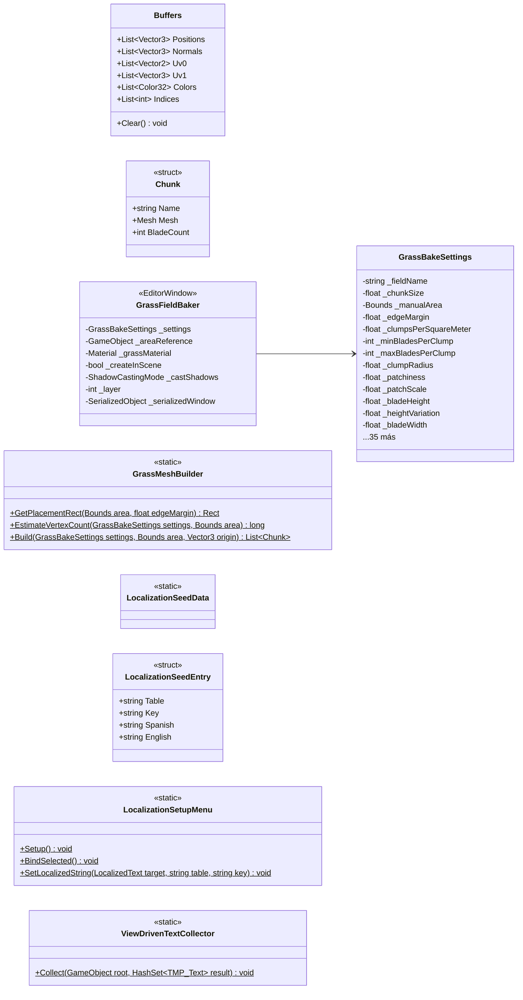

# Módulo Editor

Carpeta `Assets/Scripts/Editor/` · 9 tipos. Las cajas punteadas son tipos de otros módulos.

Leyenda: `--|>` hereda · `..|>` implementa · `-->` tiene un campo/propiedad de ese tipo. Se muestran campos `[SerializeField]` y la API pública.

## Diagrama de clases

## Tipos

| Tipo | Clase | Descripción |
|---|---|---|
| [[Buffers]] | class |  |
| [[Chunk]] | struct |  |
| [[GrassBakeSettings]] | class | Authoring parameters for `GrassMeshBuilder`. Serialized by `GrassFieldBaker`. |
| [[GrassFieldBaker]] | EditorWindow | Authoring window: bakes a chunked grass-blade field into a mesh asset under Assets/Art/Models/Generated/ and optionally instantiates it in t… |
| [[GrassMeshBuilder]] | static | Deterministically generates chunked grass-blade meshes for the AlienFarms/GrassBlades shader. Vertex layout: UV0 = (across, height 0..1), UV… |
| [[LocalizationSeedData]] | static | Initial ES/EN values for every localization key. Spanish values match the texts authored in scenes/prefabs (so "Bind Selected" can match the… |
| [[LocalizationSeedEntry]] | struct | One string table entry seeded by `LocalizationSetupMenu`. |
| [[LocalizationSetupMenu]] | static | Idempotent localization setup: creates whatever is missing (settings, es/en locales, UI/HowToPlay tables and their entries) and enforces the… |
| [[ViewDrivenTextCollector]] | static | Finds TMP texts referenced by AlienFarms components (views write them from code, so they must never get a static `LocalizedText`). Localized… |

## Depende de
[[Modulo UI|UI]] (4)