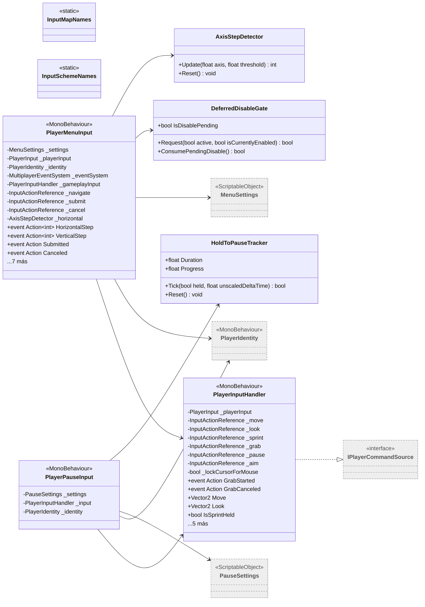

# Módulo Input

Carpeta `Assets/Scripts/Input/` · 8 tipos. Las cajas punteadas son tipos de otros módulos.

Leyenda: `--|>` hereda · `..|>` implementa · `-->` tiene un campo/propiedad de ese tipo. Se muestran campos `[SerializeField]` y la API pública.

## Diagrama de clases

## Tipos

| Tipo | Clase | Descripción |
|---|---|---|
| [[AxisStepDetector]] | class | Plain C# edge detector that turns a continuous axis (stick, dpad) into discrete steps: -1 or +1 once when the axis crosses the threshold, 0 … |
| [[DeferredDisableGate]] | class | Plain C# helper for a component that may be enabled at once but must only be disabled later (e.g. an EventSystem that cannot be disabled fro… |
| [[HoldToPauseTracker]] | class | Plain C# hold-to-confirm timer: accumulates while a button is held and reports completion once. After completing, the button must be release… |
| [[InputMapNames]] | static | Action map names defined in AlienFarmsControls.inputactions. |
| [[InputSchemeNames]] | static | Control scheme names defined in AlienFarmsControls.inputactions. |
| [[PlayerInputHandler]] | MonoBehaviour | Reads gameplay input from this player's own `PlayerInput`. The serialized `InputActionReference`s only identify actions; the live actions ar… |
| [[PlayerMenuInput]] | MonoBehaviour | Per-player menu navigation. `EnterMenu` switches this player's `PlayerInput` to the UI map and scopes its own `MultiplayerEventSystem` to a … |
| [[PlayerPauseInput]] | MonoBehaviour | Hold-to-pause for one player: holding this player's Pause button for `PauseSettings.HoldDuration` (unscaled) raises `GameEvents.OnPauseReque… |

## Depende de
[[Modulo Core|Core]] (6), [[Modulo Data|Data]] (2)