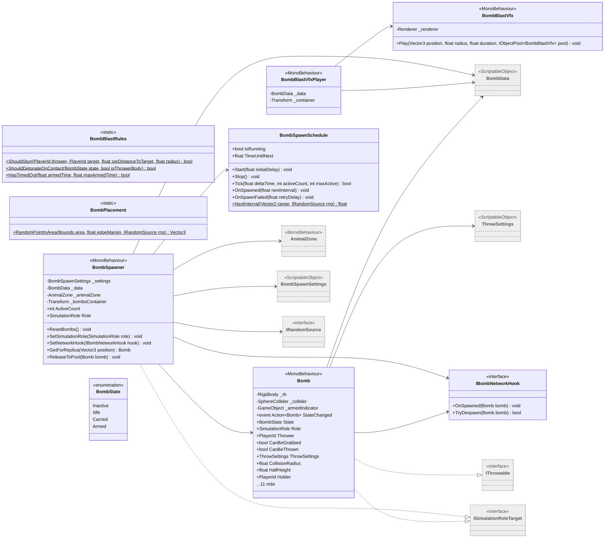

# Módulo Items

Carpeta `Assets/Scripts/Items/` · 9 tipos. Las cajas punteadas son tipos de otros módulos.

Leyenda: `--|>` hereda · `..|>` implementa · `-->` tiene un campo/propiedad de ese tipo. Se muestran campos `[SerializeField]` y la API pública.

## Diagrama de clases

## Tipos

| Tipo | Clase | Descripción |
|---|---|---|
| [[Bomb]] | MonoBehaviour | Pooled stun bomb. Inert while lying around or dropped (Idle): anyone can carry it, it never explodes. Thrown, it is Armed and explodes on it… |
| [[BombBlastRules]] | static | Pure rules of the stun bomb (who gets stunned, when it explodes). No Unity state, fully testable. |
| [[BombBlastVfx]] | MonoBehaviour | Pooled blast effect: a sphere that expands to the blast size and fades out, then returns to its pool. |
| [[BombBlastVfxPlayer]] | MonoBehaviour | Plays a pooled `BombBlastVfx` on every `GameEvents.OnBombDetonated`. |
| [[BombPlacement]] | static | Pure placement helper for bomb spawns. |
| [[BombSpawnSchedule]] | class | Pure spawn timer for bombs. Counts down only while running and while there is a free slot (the timer pauses while the max number of bombs is… |
| [[BombSpawner]] | MonoBehaviour | Scene composition root for stun bombs: owns the bomb pool and drops bombs at random free spots of the Animal Zone while a round is playing (… |
| [[BombState]] | enumeration | Lifecycle of a pooled `Bomb`. |
| [[IBombNetworkHook]] | interface | Lets a network layer follow the authority's bomb lifecycle. Without a hook, bombs go straight back to their pool on despawn (local mode). |

## Depende de
[[Modulo Animals|Animals]] (2), [[Modulo Core|Core]] (18), [[Modulo Data|Data]] (5), [[Modulo Utilities|Utilities]] (4), [[Modulo Zones|Zones]] (1)