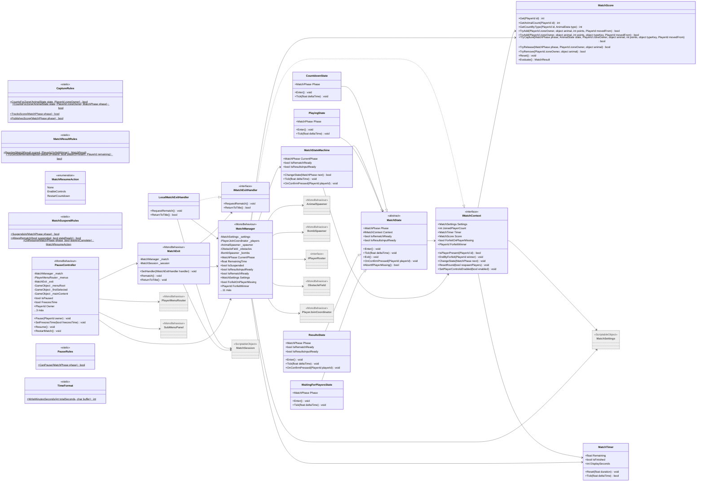

# Módulo Match

Carpeta `Assets/Scripts/Match/` · 20 tipos. Las cajas punteadas son tipos de otros módulos.

Leyenda: `--|>` hereda · `..|>` implementa · `-->` tiene un campo/propiedad de ese tipo. Se muestran campos `[SerializeField]` y la API pública.

## Diagrama de clases

## Tipos

| Tipo | Clase | Descripción |
|---|---|---|
| [[CaptureRules]] | static | Pure scoring rules. The score is zone occupancy: an animal counts for a zone's owner while it is captured there, whoever released it. Carrie… |
| [[CountdownState]] | class | Resets the round, freezes players and counts down before play starts. |
| [[IMatchContext]] | interface | What match states may read and do. Implemented by MatchManager (and by test fakes). |
| [[IMatchExitHandler]] | interface | What the match exit buttons do. Local: `LocalMatchExitHandler`; online, a network handler. |
| [[LocalMatchExitHandler]] | class | Local split-screen exit: rematch through the `MatchManager`; returning to the title clears the `MatchSession` and loads the main menu (time … |
| [[MatchExit]] | MonoBehaviour | Exit options of a finished (or paused) match, wired to menu buttons: rematch or back to the title screen. What they do is delegated to an `I… |
| [[MatchManager]] | MonoBehaviour | Scene composition root of the match: owns the phase state machine, score and timer, and bridges them to the players (via `PlayerJoinCoordina… |
| [[MatchResultRules]] | static | How the published `MatchResult` is built from the scored one. Shared by the match (server / local) and the online replica, so both raise the… |
| [[MatchResumeAction]] | enumeration | What the match does when a suspension ends (see `MatchSuspendRules.OnResume`). |
| [[MatchScore]] | class | Zone occupancy for the current round: the animals each player's zone holds, the points each one is worth and its type. A player's score is t… |
| [[MatchState]] | abstract | Base of the match State pattern. Plain C# (testable in EditMode). Rule: no state calls `IMatchContext.ChangeState` from `Enter`; transitions… |
| [[MatchStateMachine]] | class | Plain C# match state machine: owns one state per `MatchPhase` and performs transitions. Side effects (players, animals, score, timer) live i… |
| [[MatchSuspendRules]] | static | Pure rules of a match suspension (online reconnection grace): which phases are suspended and what to do when the suspension ends. |
| [[MatchTimer]] | class | Countdown of the round time. Driven externally with `Tick` (no Time.* access). |
| [[PauseController]] | MonoBehaviour | Game pause: freezes time (`Time.timeScale` = 0) and audio, and routes the pause menu to the player who requested it; the other player is blo… |
| [[PauseRules]] | static | Pure rules for when the game may be paused. |
| [[PlayingState]] | class | Round in progress: timer runs (1 Hz event) and score changes are published. A missing player either aborts the round (local) or ends it as a… |
| [[ResultsState]] | class | Round over: publishes the result, freezes players and restarts on Confirm after a short delay. A forfeit result (the rival left during Playi… |
| [[TimeFormat]] | static | Allocation-free time formatting into reusable char buffers. |
| [[WaitingForPlayersState]] | class | Free roam until both players have joined; captures are not scored (the countdown resets the round). |

## Depende de
[[Modulo Animals|Animals]] (4), [[Modulo Core|Core]] (34), [[Modulo Data|Data]] (6), [[Modulo Items|Items]] (1), [[Modulo Networking|Networking]] (6), [[Modulo Player|Player]] (3), [[Modulo UI|UI]] (1), [[Modulo Zones|Zones]] (1)