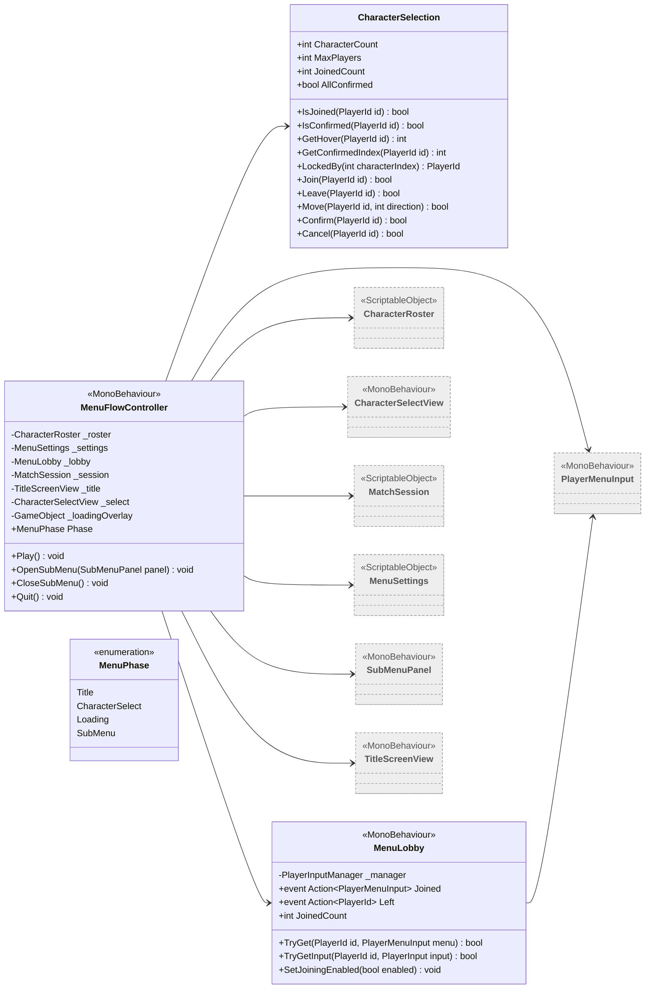

# Módulo Menu

Carpeta `Assets/Scripts/Menu/` · 4 tipos. Las cajas punteadas son tipos de otros módulos.

Leyenda: `--|>` hereda · `..|>` implementa · `-->` tiene un campo/propiedad de ese tipo. Se muestran campos `[SerializeField]` y la API pública.

## Diagrama de clases

## Tipos

| Tipo | Clase | Descripción |
|---|---|---|
| [[CharacterSelection]] | class | Plain C# model of the character select screen: which players joined, which character each one hovers and which characters are locked (confir… |
| [[MenuFlowController]] | MonoBehaviour | MainMenu composition root: Title -> CharacterSelect -> Loading. On the title the first joined player owns the buttons (the other is blocked)… |
| [[MenuLobby]] | MonoBehaviour | MainMenu player registry: listens to `PlayerInputManager` (MenuPlayer prefab), assigns each joined player its `PlayerId` from the player ind… |
| [[MenuPhase]] | enumeration | Screens of the MainMenu scene, in flow order. |

## Depende de
[[Modulo Core|Core]] (5), [[Modulo Data|Data]] (5), [[Modulo Input|Input]] (2), [[Modulo UI|UI]] (4)