# Módulo Menu

Carpeta `Assets/Scripts/Menu/` · 12 tipos. Las cajas punteadas son tipos de otros módulos.

Leyenda: `--|>` hereda · `..|>` implementa · `-->` tiene un campo/propiedad de ese tipo. Se muestran campos `[SerializeField]` y la API pública.

## Diagrama de clases

```mermaid
classDiagram
  direction LR
  class CharacterSelection {
    +int CharacterCount
    +int MaxPlayers
    +int JoinedCount
    +bool AllConfirmed
    +IsJoined(PlayerId id) bool
    +IsConfirmed(PlayerId id) bool
    +GetHover(PlayerId id) int
    +GetConfirmedIndex(PlayerId id) int
    +LockedBy(int characterIndex) PlayerId
    +Join(PlayerId id) bool
    +Leave(PlayerId id) bool
    +Move(PlayerId id, int direction) bool
    +Confirm(PlayerId id) bool
    +Cancel(PlayerId id) bool
  }
  class MenuCameraRig {
    <<MonoBehaviour>>
    -CinemachineBrain _brain
    -CinemachineCamera _skyCamera
    -CinemachineCamera _menuCamera
    +Show(MenuCameraShot shot, CinemachineBlendDefinition blend) void
    +Cut(MenuCameraShot shot) void
    +FinishBlend() void
    +IsSettledOn(MenuCameraShot shot) bool
  }
  class MenuCameraShot {
    <<enumeration>>
    Sky
    Menu
  }
  class MenuFlowController {
    <<MonoBehaviour>>
    -CharacterRoster _roster
    -MenuSettings _settings
    -MenuLobby _lobby
    -MatchSession _session
    -TitleScreenView _title
    -TitleIntroDirector _intro
    -CharacterSelectView _select
    -GameObject _loadingOverlay
    -OnlineMenuController _online
    -OnlineSessionChannel _onlineSession
    -GameObject _playOnlineButton
    +MenuPhase Phase
    +Play() void
    ...4 más
  }
  class MenuLobby {
    <<MonoBehaviour>>
    -PlayerInputManager _manager
    +event Action~PlayerMenuInput~ Joined
    +event Action~PlayerId~ Left
    +int JoinedCount
    +TryGet(PlayerId id, PlayerMenuInput menu) bool
    +TryGetInput(PlayerId id, PlayerInput input) bool
    +SetJoiningEnabled(bool enabled) void
  }
  class MenuPhase {
    <<enumeration>>
    Title
    CharacterSelect
    Loading
    SubMenu
    Online
  }
  class OnlineMenuController {
    <<MonoBehaviour>>
    -OnlineSessionChannel _session
    -OnlineLobbyChannel _lobby
    -CharacterRoster _roster
    -PlayerProgressChannel _progress
    -OnlinePanelView _view
    +event Action ExitRequested
    +bool IsActive
    +bool IsLoadingMatch
    +Enter(PlayerMenuInput owner) void
    +Exit() void
    +RefreshFocus() void
    +HandleCancel() bool
    +CreateRoom() void
    ...7 más
  }
  class OnlineMenuRules {
    <<static>>
    +Resolve(OnlineSessionStatus status, OnlineLobbyPhase lobbyPhase, bool wantsJoin)$ OnlineScreen
    +BusyKey(OnlineSessionStatus status, OnlineLobbyPhase lobbyPhase)$ string
    +CanCancelBusy(OnlineSessionStatus status)$ bool
    +OpensOnlineOnLoad(bool inOnlineSession, bool returnToOnlineRequested)$ bool
    +WantsJoinAfterCancelBusy(OnlineSessionStatus status, bool wantsJoin)$ bool
    +ShowsRejoin(bool hasOffer, double expiresAt, double now)$ bool
    +RejoinSecondsLeft(double expiresAt, double now)$ int
    +HintKey(OnlineLobbyPhase lobbyPhase, int seatCount, bool allPicked, bool isHost)$ string
  }
  class TitleIntroDirector {
    <<MonoBehaviour>>
    -TitleIntroSettings _settings
    -TitleScreenView _view
    -MenuCameraRig _cameraRig
    +event Action MenuReady
    +TitleIntroState State
    +bool IsMenuInteractable
    +bool IsTransitioning
    +SnapToAttract() void
    +SnapToMenu() void
    +PlayToMenu() void
    +PlayToAttract() void
    +Skip() void
  }
  class TitleIntroModel {
    +TitleIntroState State
    +float AttractAlpha
    +float MenuAlpha
    +bool IsMenuInteractable
    +bool IsTransitioning
    +MenuCameraShot CameraTarget
    +SnapToAttract() void
    +SnapToMenu() void
    +RequestMenu() bool
    +RequestAttract() bool
    +Skip() bool
    +Tick(float dt, bool cameraSettledOnMenu, bool cameraSettledOnSky) bool
  }
  class TitleIntroState {
    <<enumeration>>
    Attract
    ToMenu
    Menu
    ToAttract
  }
  class TitlePromptPulse {
    <<static>>
    +Evaluate(float time, float period, float minAlpha, float maxAlpha)$ float
  }
  class CharacterRoster:::external
  <<ScriptableObject>> CharacterRoster
  class CharacterSelectView:::external
  <<MonoBehaviour>> CharacterSelectView
  class MatchSession:::external
  <<ScriptableObject>> MatchSession
  class MenuSettings:::external
  <<ScriptableObject>> MenuSettings
  class OnlineLobbyChannel:::external
  <<ScriptableObject>> OnlineLobbyChannel
  class OnlinePanelView:::external
  <<MonoBehaviour>> OnlinePanelView
  class OnlineSessionChannel:::external
  <<ScriptableObject>> OnlineSessionChannel
  class PlayerMenuInput:::external
  <<MonoBehaviour>> PlayerMenuInput
  class PlayerProgressChannel:::external
  <<ScriptableObject>> PlayerProgressChannel
  class SubMenuPanel:::external
  <<MonoBehaviour>> SubMenuPanel
  class TitleIntroSettings:::external
  <<ScriptableObject>> TitleIntroSettings
  class TitleScreenView:::external
  <<MonoBehaviour>> TitleScreenView
  MenuFlowController --> CharacterRoster
  MenuFlowController --> CharacterSelectView
  MenuFlowController --> CharacterSelection
  MenuFlowController --> MatchSession
  MenuFlowController --> MenuLobby
  MenuFlowController --> MenuSettings
  MenuFlowController --> OnlineMenuController
  MenuFlowController --> OnlineSessionChannel
  MenuFlowController --> PlayerMenuInput
  MenuFlowController --> SubMenuPanel
  MenuFlowController --> TitleIntroDirector
  MenuFlowController --> TitleScreenView
  MenuLobby --> PlayerMenuInput
  OnlineMenuController --> CharacterRoster
  OnlineMenuController --> OnlineLobbyChannel
  OnlineMenuController --> OnlinePanelView
  OnlineMenuController --> OnlineSessionChannel
  OnlineMenuController --> PlayerMenuInput
  OnlineMenuController --> PlayerProgressChannel
  TitleIntroDirector --> MenuCameraRig
  TitleIntroDirector --> TitleIntroModel
  TitleIntroDirector --> TitleIntroSettings
  TitleIntroDirector --> TitleScreenView
  classDef external fill:#eee,stroke:#999,stroke-dasharray: 4 3,color:#555
```

## Tipos

| Tipo | Clase | Descripción |
|---|---|---|
| [[CharacterSelection]] | class | Plain C# model of the character select screen: which players joined, which character each one hovers and which characters are locked (confir… |
| [[MenuCameraRig]] | MonoBehaviour |  |
| [[MenuCameraShot]] | enumeration |  |
| [[MenuFlowController]] | MonoBehaviour | MainMenu composition root: Title or SubMenu -> CharacterSelect -> Loading. On the title the first joined player owns the buttons (the other … |
| [[MenuLobby]] | MonoBehaviour | MainMenu player registry: listens to `PlayerInputManager` (MenuPlayer prefab), assigns each joined player its `PlayerId` from the player ind… |
| [[MenuPhase]] | enumeration | Screens of the MainMenu scene, in flow order. |
| [[OnlineMenuController]] | MonoBehaviour | Online phase of the MainMenu (hub, join, room) for the title owner. Talks to the network only through the `OnlineSessionChannel` and `Online… |
| [[OnlineMenuRules]] | static | Pure rules of the online menu: which screen the session and lobby state lead to, and which localization keys the busy label and the room hin… |
| [[TitleIntroDirector]] | MonoBehaviour |  |
| [[TitleIntroModel]] | class |  |
| [[TitleIntroState]] | enumeration |  |
| [[TitlePromptPulse]] | static |  |

## Depende de
[[Modulo Core|Core]] (19), [[Modulo Data|Data]] (13), [[Modulo Input|Input]] (3), [[Modulo Networking|Networking]] (4), [[Modulo UI|UI]] (8)