# Módulo Networking

Carpeta `Assets/Scripts/Networking/` · 32 tipos. Las cajas punteadas son tipos de otros módulos.

Leyenda: `--|>` hereda · `..|>` implementa · `-->` tiene un campo/propiedad de ese tipo. Se muestran campos `[SerializeField]` y la API pública.

## Diagrama de clases

```mermaid
classDiagram
  direction LR
  class ApprovalDecision {
    <<struct>>
    +bool Approved
    +string Reason
    +Approve()$ ApprovalDecision
    +Reject(string reason)$ ApprovalDecision
  }
  class ApprovalRules {
    <<static>>
    +Evaluate(bool payloadValid, ConnectionPayload payload, int protocolVersion, int occupiedSeats, int maxPlayers)$ ApprovalDecision
  }
  class ConnectionApprovalHandler {
    <<MonoBehaviour>>
    -NetworkSettings _settings
    -NetworkManager _manager
    +ServerSlotDirectory Slots
  }
  class ConnectionPayload {
    <<struct>>
    +int ProtocolVersion
    +FixedString32Bytes DisplayName
    +byte CharacterIndex
    +FixedString64Bytes UgsPlayerId
    +Create(int protocolVersion, string displayName, int characterIndex)$ ConnectionPayload
    +bool HasCharacter
    +NetworkSerialize(BufferSerializer~T~ serializer) void
    +ToBytes() byte[]
    +TryParse(byte data, ConnectionPayload payload)$ bool
  }
  class DevConnectionPanel {
    <<MonoBehaviour>>
    -NetworkRuntimeAnchor _anchor
    -MatchSession _session
    -NetworkSettings _settings
    -CharacterRoster _characters
    -string _displayName
    -TMP_Text _statusLabel
    -TMP_InputField _addressField
    +Host() void
    +Client() void
    +Shutdown() void
  }
  class DirectConnection {
    <<MonoBehaviour>>
    -UnityTransport _transport
    -string _address
    -int _port
    -string _listenAddress
    +string Address
    +int Port
    +SetAddress(string address) void
    +StartHostAsync(NetworkManager manager) Task~bool~
    +StartClientAsync(NetworkManager manager) Task~bool~
  }
  class DisconnectReasons {
    <<static>>
    +IsKnown(string reason)$ bool
    +Normalize(string reason)$ string
  }
  class IConnectionStrategy {
    <<interface>>
    +StartHostAsync(NetworkManager manager) Task~bool~
    +StartClientAsync(NetworkManager manager) Task~bool~
  }
  class InputCommandBatch {
    <<struct>>
    +int Count
    +Push(PlayerInputCommand command) void
    +Get(int index) PlayerInputCommand
    +Clear() void
    +NetworkSerialize(BufferSerializer~T~ serializer) void
  }
  class InputCommandBuffer {
    +int TargetDepth
    +int PendingCount
    +uint LastConsumedSeq
    +Enqueue(PlayerInputCommand command) bool
    +Consume(bool fresh) PlayerInputCommand
    +Clear() void
  }
  class InterpolatedPose {
    <<struct>>
    +Vector3 Position
    +Vector3 Velocity
    +float FacingYaw
    +float StunRemaining
    +PlayerSnapshotFlags Flags
    +bool IsClamped
    +Vector3 FacingDirection
  }
  class LocalPlayerRigLookup {
    <<MonoBehaviour>>
    -NetworkRuntimeAnchor _anchor
    +TryGetRig(PlayerId id, PlayerRig rig) bool
  }
  class Mode {
    <<enumeration>>
    Idle
    OwnerSender
    ServerReceiver
  }
  class NetworkCommandSource {
    +event Action GrabStarted
    +event Action GrabCanceled
    +Vector2 Move
    +Vector2 Look
    +bool IsLookPointerDelta
    +bool IsSprintHeld
    +bool IsGrabHeld
    +bool IsAimHeld
    +Apply(PlayerInputCommand command) void
    +Reset() void
  }
  class NetworkPlayer {
    -CharacterRoster _characters
    -NetworkRuntimeAnchor _anchor
    -PlayerRig _rig
    -PlayerIdentity _identity
    -PlayerAppearance _appearance
    -PlayerMovement _movement
    -PlayerGrabber _grabber
    -PlayerStunReceiver _stunReceiver
    -NetworkPlayerMotion _motion
    -PlayerInput _playerInput
    -Camera _camera
    -AudioListener _audioListener
    -Behaviour[] _ownerOnlyBehaviours
    ...9 más
  }
  class NetworkPlayerInput {
    -NetworkSettings _settings
    -PlayerInputHandler _localInput
    -ThirdPersonCamera _camera
    -PlayerMovement _movement
    -PlayerGrabber _grabber
    -PlayerAim _aim
    +uint LastAppliedSeq
    +OnNetworkSpawn() void
    +OnNetworkDespawn() void
  }
  class NetworkPlayerMotion {
    -NetworkSettings _settings
    -PlayerMovement _movement
    -Rigidbody _rb
    -NetworkPlayerInput _input
    +int BufferedSnapshots
    +OnNetworkSpawn() void
    +MarkTeleport() void
  }
  class NetworkPlayerRoster {
    <<MonoBehaviour>>
    -NetworkRuntimeAnchor _anchor
    -CharacterRoster _characters
    -NetworkObject _playerPrefab
    -Transform[] _spawnPoints
    +int JoinedCount
    +TryGetRig(PlayerId id, PlayerRig rig) bool
    +RespawnAll() void
    +SetControlsEnabled(bool enabled) void
  }
  class NetworkRootLifetime {
    <<MonoBehaviour>>
    -NetworkRuntimeAnchor _anchor
    -NetworkManager _manager
    -ConnectionApprovalHandler _approval
    -NetworkSceneLoader _sceneLoader
    -MonoBehaviour _connection
    +NetworkManager Manager
    +ConnectionApprovalHandler Approval
    +NetworkSceneLoader SceneLoader
    +IConnectionStrategy Connection
    +Teardown() void
    +ShutdownSession() void
  }
  class NetworkRuntimeAnchor {
    <<ScriptableObject>>
    +NetworkRootLifetime Root
    +bool HasRoot
    +NetworkManager Manager
    +ConnectionApprovalHandler Approval
    +ServerSlotDirectory Slots
    +NetworkSceneLoader SceneLoader
    +IConnectionStrategy Connection
    +NetworkPlayer LocalPlayer
    +bool IsServer
    +bool IsPureClient
    +Publish(NetworkRootLifetime root) void
    +SetLocalPlayer(NetworkPlayer player) void
    +ClearLocalPlayer(NetworkPlayer player) void
    ...3 más
  }
  class NetworkSceneLoader {
    <<MonoBehaviour>>
    -NetworkManager _manager
    +bool IsLoading
    +event Action~string~ LoadCompleted
    +LoadGameplay() bool
  }
  class OnlineMatchBootstrap {
    <<MonoBehaviour>>
    -NetworkRuntimeAnchor _anchor
    -MatchSession _session
    -MatchManager _match
    -MatchExit _exit
    -AnimalSpawner _animalSpawner
    -BombSpawner _bombSpawner
    -ObstacleField _obstacles
    +SimulationRole AppliedRole
  }
  class OnlineMatchExitHandler {
    +RequestRematch() void
    +ReturnToTitle() bool
  }
  class PlayerInputCommand {
    <<struct>>
    +uint Seq
    +sbyte MoveX
    +sbyte MoveY
    +ushort YawQuantized
    +short PitchCentidegrees
    +byte Buttons
    +Create(uint seq, Vector2 move, float yaw, float pitch, bool sprint, bool grab, bool aim)$ PlayerInputCommand
    +Vector2 Move
    +float Yaw
    +float Pitch
    +bool IsSprintHeld
    +bool IsGrabHeld
    +bool IsAimHeld
    +NetworkSerialize(BufferSerializer~T~ serializer) void
  }
  class PlayerSlot {
    <<struct>>
    +PlayerId Id
    +ulong ClientId
    +FixedString32Bytes DisplayName
    +byte CharacterIndex
    +bool Connected
    +FixedString64Bytes UgsPlayerId
    +double DisconnectedAt
    +Vector3 SavedPosition
    +float SavedFacingYaw
    +bool IsOccupied
  }
  class PlayerSnapshot {
    <<struct>>
    +uint Tick
    +double ServerTime
    +Vector3 Position
    +Vector3 Velocity
    +float FacingYaw
    +float StunRemaining
    +uint AckSeq
    +byte TeleportEpoch
    +PlayerSnapshotFlags Flags
    +NetworkSerialize(BufferSerializer~T~ serializer) void
  }
  class PlayerSnapshotFlags {
    <<enumeration>>
    None
    Sprinting
    Aiming
  }
  class ServerSlotDirectory {
    +int ConnectedCount
    +TryAssign(ulong clientId, ConnectionPayload payload, PlayerId id) bool
    +TryGetByClient(ulong clientId, PlayerSlot slot) bool
    +TryGet(PlayerId id, PlayerSlot slot) bool
    +Release(ulong clientId, PlayerId id) bool
    +Clear() void
  }
  class SnapshotAddResult {
    <<enumeration>>
    Rejected
    Added
    Reset
  }
  class SnapshotBuffer {
    +int Count
    +int Capacity
    +TryGetNewest(PlayerSnapshot snapshot) bool
    +Add(PlayerSnapshot snapshot) SnapshotAddResult
    +Clear() void
  }
  class SnapshotInterpolator {
    <<static>>
    +TrySample(SnapshotBuffer buffer, double renderTime, InterpolatedPose pose)$ bool
  }
  class Status {
    <<enumeration>>
    NoRoot
    Offline
    Starting
    Hosting
    Connecting
    Connected
  }
  class AnimalSpawner:::external
  <<MonoBehaviour>> AnimalSpawner
  class BombSpawner:::external
  <<MonoBehaviour>> BombSpawner
  class CharacterDefinition:::external
  <<ScriptableObject>> CharacterDefinition
  class CharacterRoster:::external
  <<ScriptableObject>> CharacterRoster
  class IMatchExitHandler:::external
  <<interface>> IMatchExitHandler
  class IPlayerCommandSource:::external
  <<interface>> IPlayerCommandSource
  class IPlayerRigLookup:::external
  <<interface>> IPlayerRigLookup
  class IPlayerRoster:::external
  <<interface>> IPlayerRoster
  class MatchExit:::external
  <<MonoBehaviour>> MatchExit
  class MatchManager:::external
  <<MonoBehaviour>> MatchManager
  class MatchSession:::external
  <<ScriptableObject>> MatchSession
  class NetworkSettings:::external
  <<ScriptableObject>> NetworkSettings
  class ObstacleField:::external
  <<MonoBehaviour>> ObstacleField
  class PlayerAim:::external
  <<MonoBehaviour>> PlayerAim
  class PlayerAppearance:::external
  <<MonoBehaviour>> PlayerAppearance
  class PlayerGrabber:::external
  <<MonoBehaviour>> PlayerGrabber
  class PlayerIdentity:::external
  <<MonoBehaviour>> PlayerIdentity
  class PlayerInputHandler:::external
  <<MonoBehaviour>> PlayerInputHandler
  class PlayerMovement:::external
  <<MonoBehaviour>> PlayerMovement
  class PlayerRig:::external
  <<MonoBehaviour>> PlayerRig
  class PlayerStunReceiver:::external
  <<MonoBehaviour>> PlayerStunReceiver
  class ThirdPersonCamera:::external
  <<MonoBehaviour>> ThirdPersonCamera
  ConnectionApprovalHandler --> NetworkSettings
  ConnectionApprovalHandler --> ServerSlotDirectory
  DevConnectionPanel --> CharacterRoster
  DevConnectionPanel --> MatchSession
  DevConnectionPanel --> NetworkRuntimeAnchor
  DevConnectionPanel --> NetworkSettings
  DirectConnection ..|> IConnectionStrategy
  InputCommandBatch --> PlayerInputCommand
  InputCommandBuffer --> PlayerInputCommand
  LocalPlayerRigLookup --> NetworkRuntimeAnchor
  LocalPlayerRigLookup ..|> IPlayerRigLookup
  NetworkCommandSource ..|> IPlayerCommandSource
  NetworkPlayer --> CharacterDefinition
  NetworkPlayer --> CharacterRoster
  NetworkPlayer --> NetworkPlayerMotion
  NetworkPlayer --> NetworkRuntimeAnchor
  NetworkPlayer --> PlayerAppearance
  NetworkPlayer --> PlayerGrabber
  NetworkPlayer --> PlayerIdentity
  NetworkPlayer --> PlayerMovement
  NetworkPlayer --> PlayerRig
  NetworkPlayer --> PlayerStunReceiver
  NetworkPlayerInput --> InputCommandBatch
  NetworkPlayerInput --> InputCommandBuffer
  NetworkPlayerInput --> NetworkCommandSource
  NetworkPlayerInput --> NetworkSettings
  NetworkPlayerInput --> PlayerAim
  NetworkPlayerInput --> PlayerGrabber
  NetworkPlayerInput --> PlayerInputHandler
  NetworkPlayerInput --> PlayerMovement
  NetworkPlayerInput --> ThirdPersonCamera
  NetworkPlayerMotion --> NetworkPlayerInput
  NetworkPlayerMotion --> NetworkSettings
  NetworkPlayerMotion --> PlayerMovement
  NetworkPlayerMotion --> SnapshotBuffer
  NetworkPlayerRoster --> CharacterRoster
  NetworkPlayerRoster --> NetworkPlayer
  NetworkPlayerRoster --> NetworkRuntimeAnchor
  NetworkPlayerRoster --> NetworkSceneLoader
  NetworkPlayerRoster --> PlayerRig
  NetworkPlayerRoster ..|> IPlayerRoster
  NetworkRootLifetime --> ConnectionApprovalHandler
  NetworkRootLifetime --> IConnectionStrategy
  NetworkRootLifetime --> NetworkRuntimeAnchor
  NetworkRootLifetime --> NetworkSceneLoader
  NetworkRuntimeAnchor --> ConnectionApprovalHandler
  NetworkRuntimeAnchor --> IConnectionStrategy
  NetworkRuntimeAnchor --> NetworkPlayer
  NetworkRuntimeAnchor --> NetworkRootLifetime
  NetworkRuntimeAnchor --> NetworkSceneLoader
  NetworkRuntimeAnchor --> ServerSlotDirectory
  OnlineMatchBootstrap --> AnimalSpawner
  OnlineMatchBootstrap --> BombSpawner
  OnlineMatchBootstrap --> MatchExit
  OnlineMatchBootstrap --> MatchManager
  OnlineMatchBootstrap --> MatchSession
  OnlineMatchBootstrap --> NetworkRuntimeAnchor
  OnlineMatchBootstrap --> ObstacleField
  OnlineMatchExitHandler --> MatchManager
  OnlineMatchExitHandler --> MatchSession
  OnlineMatchExitHandler --> NetworkRuntimeAnchor
  OnlineMatchExitHandler ..|> IMatchExitHandler
  ServerSlotDirectory --> PlayerSlot
  SnapshotBuffer --> PlayerSnapshot
  classDef external fill:#eee,stroke:#999,stroke-dasharray: 4 3,color:#555
```

## Tipos

| Tipo | Clase | Descripción |
|---|---|---|
| [[ApprovalDecision]] | struct | Outcome of `ApprovalRules.Evaluate`: approved, or rejected with a reason key sent to the client. |
| [[ApprovalRules]] | static | Pure connection approval rules (version 1.5): valid payload, same protocol and a free seat. Reconnection to a previous seat and spectators c… |
| [[ConnectionApprovalHandler]] | MonoBehaviour | Server connection approval (version 1.5): parses the `ConnectionPayload`, applies `ApprovalRules` and seats the client in the `ServerSlotDir… |
| [[ConnectionPayload]] | struct | What a client sends in `NetworkConfig.ConnectionData` when it connects. Written by the client, read by the server's approval. `UgsPlayerId` … |
| [[DevConnectionPanel]] | MonoBehaviour | Development connection panel (logic only; the Canvas lives in the scene). Host / Client / Shutdown are wired to buttons' OnClick. Host and C… |
| [[DirectConnection]] | MonoBehaviour | Direct IP connection (Multiplayer Play Mode, LAN or the relay fallback): sets the UnityTransport address and port, then starts NGO synchrono… |
| [[DisconnectReasons]] | static | The only disconnect / rejection reasons the game sends, as stable keys the UI maps to text. NGO fills DisconnectReason with raw transport te… |
| [[IConnectionStrategy]] | interface | How a session is started: direct IP (`DirectConnection`) or, later, Sessions + Relay. Asynchronous so a relay allocation fits the same contr… |
| [[InputCommandBatch]] | struct | The last `MaxCommands` commands of a player, newest first, sent in every unreliable input packet so a lost packet is recovered by the next o… |
| [[InputCommandBuffer]] | class | Server-side jitter buffer of one player's commands, consumed one per physics step. Waits until `TargetDepth` commands are queued before play… |
| [[InterpolatedPose]] | struct | Pose sampled by `SnapshotInterpolator` at a render time. |
| [[LocalPlayerRigLookup]] | MonoBehaviour | Online `IPlayerRigLookup` for the shared menus (pause, results): only the avatar this machine owns is found, so a menu is routed to the loca… |
| [[Mode]] | enumeration |  |
| [[NetworkCommandSource]] | class | `IPlayerCommandSource` fed with network commands (server side of a remote player). Holds the last applied command and raises `GrabStarted` /… |
| [[NetworkPlayer]] | class | Network identity of a Player_Net avatar. The roster hands PlayerId, character and name over before spawning and the server writes them in On… |
| [[NetworkPlayerInput]] | class | Input over the network, one command per physics step. Owner (pure client): samples its `PlayerInputHandler` and camera view and sends the la… |
| [[NetworkPlayerMotion]] | class | Player position sync with custom snapshots (no NetworkTransform: later prediction and lag compensation need to know which server time is dra… |
| [[NetworkPlayerRoster]] | MonoBehaviour | Online `IPlayerRoster` (server only): spawns a Player_Net as the player object of every seated client at its seat's spawn point, keeps the r… |
| [[NetworkRootLifetime]] | MonoBehaviour | Lifetime of the persistent NetworkRoot: the first instance survives scene loads and publishes its services on the `NetworkRuntimeAnchor`; an… |
| [[NetworkRuntimeAnchor]] | ScriptableObject | Runtime anchor: the persistent NetworkRoot publishes its services here so scene objects (roster, bootstrap, dev panel) reach them through a … |
| [[NetworkSceneLoader]] | MonoBehaviour | Server-side scene loading through NGO scene management: the host loads the gameplay scene (Single) and every client, including late joiners,… |
| [[OnlineMatchBootstrap]] | MonoBehaviour | Online setup of the shared match objects. Pure client: the match is the server's, so MatchManager is disabled and the spawners and obstacle … |
| [[OnlineMatchExitHandler]] | class | Online match exit (version 1.5). Back to title: clears the session, tears the NetworkRoot down (shutdown + destroy; the MainMenu brings a fr… |
| [[PlayerInputCommand]] | struct | One physics step of a player's input, quantized for the wire (11 bytes): sequence, move (sbyte per axis), camera view (yaw as ushort over 36… |
| [[PlayerSlot]] | struct | Server-side record of one player seat. Reconnection fields (`UgsPlayerId`, `DisconnectedAt`, `SavedPosition`, `SavedFacingYaw`) are reserved… |
| [[PlayerSnapshot]] | struct | Authoritative state of one player after a server physics step, sent unreliably every step. `ServerTime` is on the NGO server clock, so clien… |
| [[PlayerSnapshotFlags]] | enumeration | Bit flags of a `PlayerSnapshot` (teleports travel as `PlayerSnapshot.TeleportEpoch`). |
| [[ServerSlotDirectory]] | class | Server-side seat table: which client holds Player1 / Player2. Plain C#, owned by the approval handler and shared with the roster through the… |
| [[SnapshotAddResult]] | enumeration | What `SnapshotBuffer.Add` did with a snapshot. |
| [[SnapshotBuffer]] | class | Fixed ring of received `PlayerSnapshot`s, oldest first and strictly increasing by tick. Out-of-order or duplicate snapshots are dropped; whe… |
| [[SnapshotInterpolator]] | static | Samples a `SnapshotBuffer` at a render time (server clock): linear between the two snapshots around it, clamped to the oldest / newest outsi… |
| [[Status]] | enumeration |  |

## Depende de
[[Modulo Animals|Animals]] (1), [[Modulo Core|Core]] (21), [[Modulo Data|Data]] (16), [[Modulo Input|Input]] (2), [[Modulo Items|Items]] (1), [[Modulo Match|Match]] (4), [[Modulo Player|Player]] (19), [[Modulo Zones|Zones]] (1)