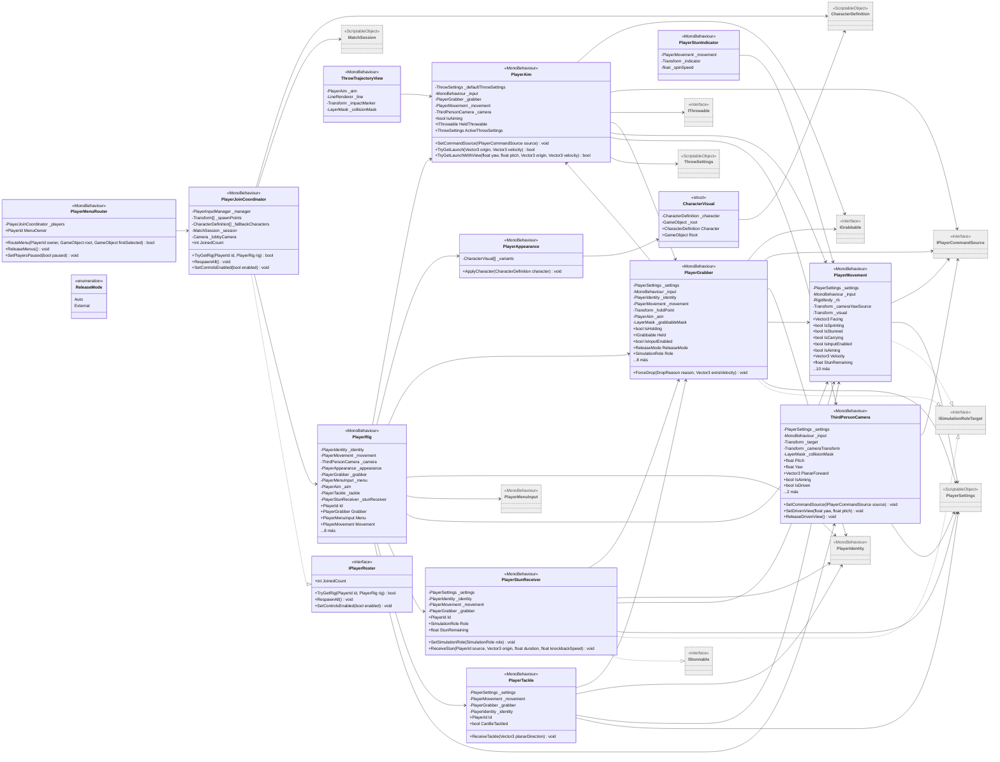

# Módulo Player

Carpeta `Assets/Scripts/Player/` · 15 tipos. Las cajas punteadas son tipos de otros módulos.

Leyenda: `--|>` hereda · `..|>` implementa · `-->` tiene un campo/propiedad de ese tipo. Se muestran campos `[SerializeField]` y la API pública.

## Diagrama de clases

## Tipos

| Tipo | Clase | Descripción |
|---|---|---|
| [[CharacterVisual]] | struct | Pairs a character with its pre-built visual root inside the Player prefab. |
| [[IPlayerRoster]] | interface | Registry of the players in the match, as the match drives them. Local: `PlayerJoinCoordinator`; online, a network roster on the server. |
| [[PlayerAim]] | MonoBehaviour | Hold-to-aim for throws. Aiming is live: Aim held, grabbing enabled, not stunned and carrying something that can be thrown. While aiming, mov… |
| [[PlayerAppearance]] | MonoBehaviour | Applies the player's character visual by activating one of the pre-built variants under the Visual child (no instantiation) and deactivating… |
| [[PlayerGrabber]] | MonoBehaviour | Hold-to-carry grabbing: while Grab is held with empty hands, picks the closest `IGrabbable` in a cone in front of the player (also catching … |
| [[PlayerJoinCoordinator]] | MonoBehaviour | Scene composition root for local multiplayer joining: listens to `PlayerInputManager` and configures each spawned player (identity, spawn po… |
| [[PlayerMenuRouter]] | MonoBehaviour | Routes a shared menu (pause, results) to a single owner: the owner navigates it with its own event system while every other joined player is… |
| [[PlayerMovement]] | MonoBehaviour | Camera-relative, Rigidbody-driven ground movement with walk/sprint speeds. The root never rotates; only `_visual` turns to face the move dir… |
| [[PlayerRig]] | MonoBehaviour | Facade on the player root that groups the per-player components, so scene composition roots configure a spawned player through a single refe… |
| [[PlayerStunIndicator]] | MonoBehaviour | Shows a spinning ring of stars over the player while it is stunned (blast or tackle). |
| [[PlayerStunReceiver]] | MonoBehaviour | Blast target on the player root: drops whatever is carried (thrown away from the blast), knocks the player back and stuns it. Stuns never st… |
| [[PlayerTackle]] | MonoBehaviour | Stealing by tackle: a sprinting player that runs into a carrier (fast enough and facing it) makes the carrier drop its animal, get knocked b… |
| [[ReleaseMode]] | enumeration | Who decides when a `PlayerGrabber` lets go of what it carries. |
| [[ThirdPersonCamera]] | MonoBehaviour | Orbit camera rig driven by this player's Look input. Lives on the CameraRig (child of the non-rotating player root); the camera is a child p… |
| [[ThrowTrajectoryView]] | MonoBehaviour | Draws the throw arc while aiming. Simulates with the same integrator and step as PhysX (`BallisticMath.Step`, Time.fixedDeltaTime, Physics.g… |

## Depende de
[[Modulo Animals|Animals]] (3), [[Modulo Core|Core]] (38), [[Modulo Data|Data]] (13), [[Modulo Input|Input]] (2), [[Modulo Items|Items]] (1), [[Modulo Utilities|Utilities]] (3)