# Módulo UI

Carpeta `Assets/Scripts/UI/` · 23 tipos. Las cajas punteadas son tipos de otros módulos.

Leyenda: `--|>` hereda · `..|>` implementa · `-->` tiene un campo/propiedad de ese tipo. Se muestran campos `[SerializeField]` y la API pública.

## Diagrama de clases

```mermaid
classDiagram
  direction LR
  class AudioOptionsView {
    <<MonoBehaviour>>
    -AudioVolumeService _service
    -Slider _master
    -Slider _music
    -Slider _sfx
    -Toggle _mute
    -TMP_Text _masterValue
    -TMP_Text _musicValue
    -TMP_Text _sfxValue
    -AudioSource _sfxPreview
    -AudioClip _sfxPreviewClip
    -UnityAction~float~ _masterChanged
  }
  class CharacterCardView {
    <<MonoBehaviour>>
    -CharacterDefinition _character
    -LocalizedString _takenByEntry
    -LocalizedString _player1Label
    -LocalizedString _player2Label
    -Image _portrait
    -TMP_Text _name
    -GameObject _lockedOverlay
    -TMP_Text _lockedBy
    -GameObject _cursorP1
    -GameObject _cursorP2
    -GameObject _readyStamp
    +CharacterDefinition Character
    +Render(bool hoverP1, bool hoverP2, PlayerId lockedBy) void
  }
  class CharacterSelectView {
    <<MonoBehaviour>>
    -GameObject _panelRoot
    -CharacterCardView[] _cards
    -PlayerSlotStatusView[] _slots
    +GameObject MenuRoot
    +Show() void
    +Hide() void
    +RenderCard(CharacterDefinition character, bool hoverP1, bool hoverP2, PlayerId lockedBy) void
    +RenderSlot(PlayerId player, PlayerSlotState state, CharacterDefinition character) void
  }
  class CountdownView {
    <<MonoBehaviour>>
    -LocalizedString _goEntry
    -GameObject _root
    -TMP_Text _text
  }
  class JoinPromptView {
    <<MonoBehaviour>>
    -GameObject _promptRoot
    -int _maxPlayers
    -MatchSession _session
  }
  class LanguageSelector {
    <<MonoBehaviour>>
    -TMP_Text _valueLabel
    +Next() void
    +Previous() void
    +OnMove(AxisEventData eventData) void
    +OnSubmit(BaseEventData eventData) void
  }
  class LocaleCycle {
    <<static>>
    +Next(int current, int count, int step)$ int
  }
  class LocalizationKeys {
    <<static>>
  }
  class LocalizedStringBinding {
    +string Value
    +Enable() void
    +Disable() void
  }
  class LocalizedText {
    <<MonoBehaviour>>
    -LocalizedString _string
    +LocalizedString String
  }
  class MatchResultsView {
    <<MonoBehaviour>>
    -LocalizedString _winnerEntry
    -LocalizedString _drawEntry
    -string _scoreFormat
    -LocalizedString _player1Label
    -LocalizedString _player2Label
    -GameObject _panelRoot
    -TMP_Text _winnerText
    -TMP_Text _scoreText
    -TMP_Text _nameP1
    -TMP_Text _nameP2
    -Image _nameStripeP1
    -Image _nameStripeP2
  }
  class MatchTimerView {
    <<MonoBehaviour>>
    -TMP_Text _text
  }
  class PauseHoldIndicatorView {
    <<MonoBehaviour>>
    -PlayerId _player
    -PauseSettings _settings
    -GameObject _root
    -Image _fill
  }
  class PauseMenuView {
    <<MonoBehaviour>>
    -LocalizedString _subtitleEntry
    -LocalizedString _player1Label
    -LocalizedString _player2Label
    -GameObject _panelRoot
    -TMP_Text _subtitle
  }
  class PlayerCharacterCache {
    +Set(PlayerId id, CharacterDefinition character) void
    +Get(PlayerId id) CharacterDefinition
    +Clear() void
  }
  class PlayerHudThemeView {
    <<MonoBehaviour>>
    -PlayerId _player
    -CharacterDefinition _default
    -TMP_Text _name
    -Image _portrait
    -Image _themeStripe
    -TMP_Text _score
  }
  class PlayerSlotState {
    <<enumeration>>
    Empty
    Choosing
    Ready
  }
  class PlayerSlotStatusView {
    <<MonoBehaviour>>
    -PlayerId _player
    -LocalizedString _emptyEntry
    -LocalizedString _choosingEntry
    -LocalizedString _readyEntry
    -Color _emptyFrameColor
    -TMP_Text _status
    -Image _frame
    +PlayerId Player
    +Render(PlayerSlotState state, CharacterDefinition character) void
  }
  class ResultsMenuController {
    <<MonoBehaviour>>
    -MatchManager _match
    -PlayerMenuRouter _menus
    -GameObject _menuRoot
    -GameObject _firstSelected
  }
  class ScoreView {
    <<MonoBehaviour>>
    -PlayerId _player
    -string _format
    -TMP_Text _text
  }
  class SelectionHighlight {
    <<MonoBehaviour>>
    -float _selectedScale
    -float _scaleSpeed
    -GameObject _focusFrame
    -RectTransform _target
    +OnSelect(BaseEventData eventData) void
    +OnDeselect(BaseEventData eventData) void
    +OnPointerEnter(PointerEventData eventData) void
  }
  class SubMenuPanel {
    <<MonoBehaviour>>
    -GameObject _firstSelected
    -GameObject _returnSelection
    +GameObject MenuRoot
    +GameObject FirstSelected
    +GameObject ReturnSelection
    +Show() void
    +Hide() void
  }
  class TitleScreenView {
    <<MonoBehaviour>>
    -GameObject _panelRoot
    -GameObject _promptRoot
    -GameObject _buttonsRoot
    -GameObject _firstSelected
    +GameObject MenuRoot
    +GameObject FirstSelected
    +Show() void
    +Hide() void
    +SetPlayerJoined(bool joined) void
  }
  class AudioVolumeService:::external
  <<MonoBehaviour>> AudioVolumeService
  class CharacterDefinition:::external
  <<ScriptableObject>> CharacterDefinition
  class MatchManager:::external
  <<MonoBehaviour>> MatchManager
  class MatchResult:::external
  <<struct>> MatchResult
  class MatchSession:::external
  <<ScriptableObject>> MatchSession
  class PauseSettings:::external
  <<ScriptableObject>> PauseSettings
  class PlayerMenuRouter:::external
  <<MonoBehaviour>> PlayerMenuRouter
  AudioOptionsView --> AudioVolumeService
  CharacterCardView --> CharacterDefinition
  CharacterCardView --> LocalizedStringBinding
  CharacterSelectView --> CharacterCardView
  CharacterSelectView --> PlayerSlotStatusView
  CountdownView --> LocalizedStringBinding
  JoinPromptView --> MatchSession
  MatchResultsView --> LocalizedStringBinding
  MatchResultsView --> MatchResult
  MatchResultsView --> PlayerCharacterCache
  PauseHoldIndicatorView --> PauseSettings
  PauseMenuView --> LocalizedStringBinding
  PauseMenuView --> PlayerCharacterCache
  PlayerCharacterCache --> CharacterDefinition
  PlayerHudThemeView --> CharacterDefinition
  PlayerSlotStatusView --> LocalizedStringBinding
  ResultsMenuController --> MatchManager
  ResultsMenuController --> PlayerMenuRouter
  classDef external fill:#eee,stroke:#999,stroke-dasharray: 4 3,color:#555
```

## Tipos

| Tipo | Clase | Descripción |
|---|---|---|
| [[AudioOptionsView]] | MonoBehaviour | Audio options panel: Master/Music/SFX sliders (linear 0..1), optional mute toggle, percentage labels and SFX preview. Reads the service when… |
| [[CharacterCardView]] | MonoBehaviour | One character card on the select screen: portrait and name of its character, which players hover it and who locked it. Rendered by `Characte… |
| [[CharacterSelectView]] | MonoBehaviour | Character select panel: forwards per-character and per-player state to its cards and slots. Driven by the menu flow after each selection cha… |
| [[CountdownView]] | MonoBehaviour | Shows the pre-round countdown ("3", "2", "1") and a short "GO" message when play starts. The GO duration comes with `GameEvents.OnCountdownF… |
| [[JoinPromptView]] | MonoBehaviour | Shows the "press a button to join" prompt while the lobby is not full. When a MainMenu session is ready the players join by themselves at St… |
| [[LanguageSelector]] | MonoBehaviour | Options row that cycles the game language. Left/Right (stick, arrows) and Submit change the locale; Up/Down navigation stays with the Select… |
| [[LocaleCycle]] | static | Index math for cycling through a list of locales with wrap-around. |
| [[LocalizationKeys]] | static | String Table Collection names and entry keys. Code-driven texts use these as LocalizedString defaults; the editor setup tool seeds every key… |
| [[LocalizedStringBinding]] | class | Keeps the resolved value of a `LocalizedString` and notifies when it changes (load or locale change). `Value` stays null until the string re… |
| [[LocalizedText]] | MonoBehaviour | Writes a localized string into the TMP text on this object and refreshes it when the locale changes. Only for static texts: never put it on … |
| [[MatchResultsView]] | MonoBehaviour | Shows the round result (winner by character name, both names and the score) while the match is in Results. The winner text is tinted with th… |
| [[MatchTimerView]] | MonoBehaviour | Shows the remaining round time as "m:ss". Updated only when the whole second changes (no per-frame work). |
| [[PauseHoldIndicatorView]] | MonoBehaviour | Shows one player's hold-to-pause progress as a filled bar. Appears only after holding for `PauseSettings.ShowProgressAfter`, never while pau… |
| [[PauseMenuView]] | MonoBehaviour | Shows the pause panel while the game is paused, with a subtitle naming who paused. Lives on an always-active object and toggles `_panelRoot`… |
| [[PlayerCharacterCache]] | class | Plain C# map from `PlayerId` to the character assigned to that player (views keep one each). |
| [[PlayerHudThemeView]] | MonoBehaviour | Styles one player's HUD block with its character: name, portrait and theme colors. The score number itself is written by `ScoreView`; this v… |
| [[PlayerSlotState]] | enumeration | Status of one player's slot on the character select screen. |
| [[PlayerSlotStatusView]] | MonoBehaviour | One player's status on the character select screen ("press to join" / "choosing" / "ready"), with the frame tinted by the hovered character'… |
| [[ResultsMenuController]] | MonoBehaviour | Gives the results menu to the winner (Player 1 on a draw) once the match accepts a rematch (`MatchManager.IsRematchReady`, the same clock th… |
| [[ScoreView]] | MonoBehaviour | Shows one player's score. Updated only on score changes. |
| [[SelectionHighlight]] | MonoBehaviour | Focus feedback for a menu button: shows a focus frame and scales up while selected. Hovering with the mouse selects the button (if interacta… |
| [[SubMenuPanel]] | MonoBehaviour | A sub-menu opened from a parent menu (Options, How to play...). Lives on the panel root itself: showing or hiding it toggles this GameObject… |
| [[TitleScreenView]] | MonoBehaviour | Title screen panel: shows the "press to start" prompt until the first player joins, then the menu buttons. Lives on an always-active object … |

## Depende de
[[Modulo Audio|Audio]] (2), [[Modulo Core|Core]] (26), [[Modulo Data|Data]] (10), [[Modulo Match|Match]] (3), [[Modulo Player|Player]] (1)