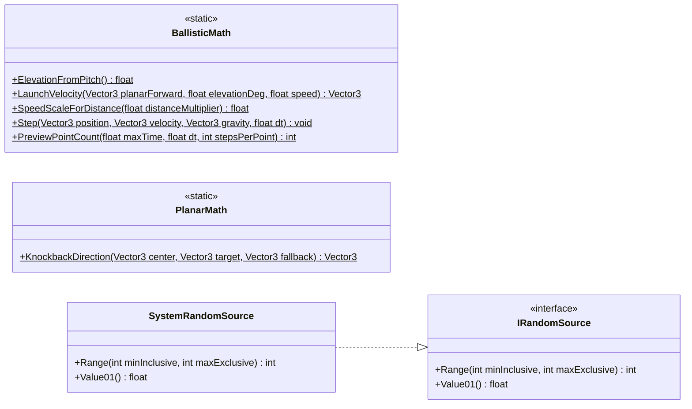

# Módulo Utilities

Carpeta `Assets/Scripts/Utilities/` · 4 tipos. Las cajas punteadas son tipos de otros módulos.

Leyenda: `--|>` hereda · `..|>` implementa · `-->` tiene un campo/propiedad de ese tipo. Se muestran campos `[SerializeField]` y la API pública.

## Diagrama de clases

## Tipos

| Tipo | Clase | Descripción |
|---|---|---|
| [[BallisticMath]] | static | Pure ballistic helpers shared by the throw and its preview. `Step` integrates exactly like PhysX (semi-implicit Euler), so a preview stepped… |
| [[IRandomSource]] | interface | Injectable random number source, so pure logic can be seeded and tested deterministically (never touches the global UnityEngine.Random state… |
| [[PlanarMath]] | static | Pure geometric helpers on the horizontal (XZ) plane. |
| [[SystemRandomSource]] | class | `IRandomSource` backed by its own `System.Random`: the same seed always yields the same sequence, independently of anything else using Unity… |