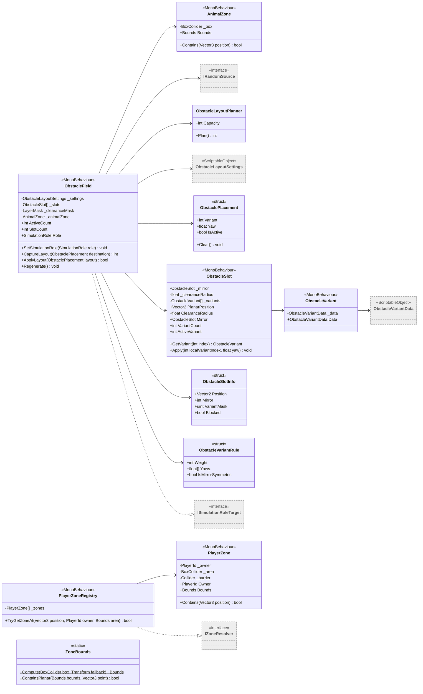

# Módulo Zones

Carpeta `Assets/Scripts/Zones/` · 11 tipos. Las cajas punteadas son tipos de otros módulos.

Leyenda: `--|>` hereda · `..|>` implementa · `-->` tiene un campo/propiedad de ese tipo. Se muestran campos `[SerializeField]` y la API pública.

## Diagrama de clases

## Tipos

| Tipo | Clase | Descripción |
|---|---|---|
| [[AnimalZone]] | MonoBehaviour | Central area where animals live. Exposes the world-space bounds of its BoxCollider so animals can be confined to it. Animals receive plain `… |
| [[ObstacleField]] | MonoBehaviour | Scene composition root of the random obstacles of the Animal Zone. Holds the scene-placed `ObstacleSlot`s and, on `Regenerate`, asks `Obstac… |
| [[ObstacleLayoutPlanner]] | class | Pure obstacle layout picker (no Unity objects, no allocations after construction, EditMode-testable). Decides which slots get an obstacle, w… |
| [[ObstaclePlacement]] | struct | Planner output for one slot: chosen table variant (-1 = empty) and yaw in degrees. |
| [[ObstacleSlot]] | MonoBehaviour | A scene-placed spot that may hold one obstacle per round. All its variants are pre-instantiated children, inactive by default; `Apply` enabl… |
| [[ObstacleSlotInfo]] | struct | Planner input for one obstacle slot. Plain value type, rebuilt in place every round. |
| [[ObstacleVariant]] | MonoBehaviour | Root of one obstacle variant prefab (pivot at ground level). Pre-instantiated, inactive, under an `ObstacleSlot`; the slot only toggles it a… |
| [[ObstacleVariantRule]] | struct | Planner rule for one entry of the variant table: relative weight and allowed yaws (degrees). |
| [[PlayerZone]] | MonoBehaviour | A player's pen. Its BoxCollider defines the capture area: an animal that lands inside counts for the owner while it stays captured. A child … |
| [[PlayerZoneRegistry]] | MonoBehaviour | Scene registry of the player pens (lives on the 'Zones' root). Animals ask it, through `IZoneResolver`, which pen they landed in. |
| [[ZoneBounds]] | static | Shared helpers to read zone areas from BoxColliders and test planar containment. |

## Depende de
[[Modulo Core|Core]] (8), [[Modulo Data|Data]] (4), [[Modulo Utilities|Utilities]] (3)