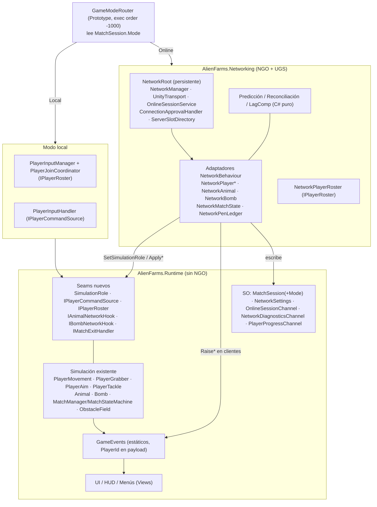
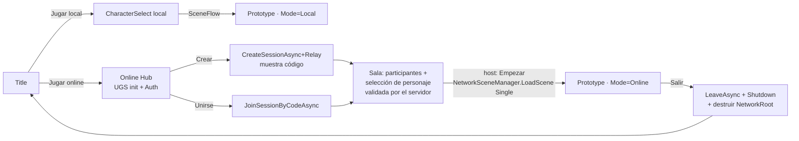
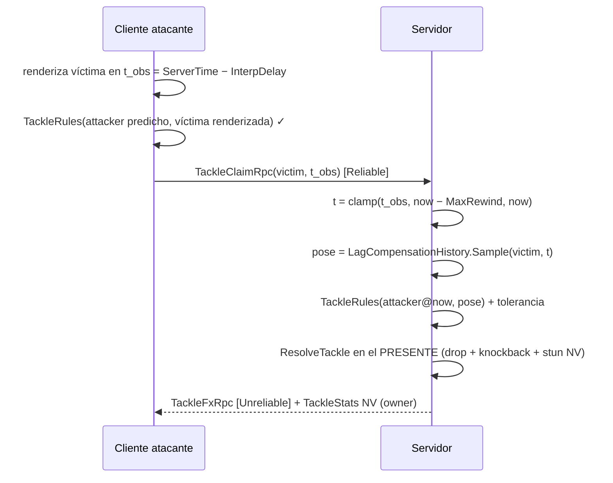

# Alien Farms: arquitectura del modo online (NGO 2.x + UGS)

> Documento de diseño y plan de trabajo, sin código de producción. Se escribió a partir de este vault y del código real de `PlayerMovement`, `PlayerGrabber`, `PlayerTackle`, `PlayerJoinCoordinator`, `PlayerRig`, `PlayerInputHandler`, `Animal`, `AnimalTypePool`, `Bomb`, `MatchManager`, `MatchState`, `MatchSession` y `MenuFlowController`.
> Lo marcado **(confirmar)** es API de paquetes que todavía no están instalados.

Ver también: [[00 Indice]] · [[Eventos GameEvents]]

---

## 1. Resumen de la arquitectura

### Decisión central: una capa de red separable y la autoridad según el rol
- **`AlienFarms.Runtime` no conoce NGO.** El gameplay actual (movimiento, agarre, animales, bomba, match) sigue siendo la única simulación. Solo se le agregan *seams* (puntos de enganche):
  1. `SimulationRole { Authority, Replica }`: cada componente que simula acepta `SetSimulationRole(...)`. El valor por defecto es `Authority`, así que el modo local queda igual que hoy.
  2. `IPlayerCommandSource`: la fuente de input que hoy consumen `PlayerMovement`, `PlayerGrabber` y `PlayerAim`. En local la implementa `PlayerInputHandler`. En online, `NetworkCommandSource`, que se alimenta con los comandos que llegan por la red.
  3. Hooks y estrategias inyectadas: `IPlayerRoster`, `IAnimalNetworkHook`, `IBombNetworkHook`, `IMatchExitHandler`.
- **El nuevo `AlienFarms.Networking`** referencia a Runtime, nunca al revés. Contiene adaptadores `NetworkBehaviour` que hacen tres cosas:
  - En el servidor, observan la simulación y escriben `NetworkVariable` y RPC.
  - En los clientes, ponen la simulación en `Replica` y aplican el estado que llega replicado.
  - En las instancias que no son servidor, disparan los mismos `GameEvents` locales.
- **Patrones usados:**
  - Adapter: los bridges de red.
  - Strategy: rol, input, conexión y salida del match.
  - Observer: `GameEvents` y los canales SO.
  - Object Pool, con `INetworkPrefabInstanceHandler`.
  - State: se reutiliza `MatchStateMachine`, que solo corre en el servidor.
- **Por qué no correr el modo local también como host de NGO:**
  - El split-screen no corre riesgo: con `Authority` por defecto, el código local se comporta exactamente igual.
  - No se duplica lógica: el servidor ejecuta las mismas clases.
  - Cada parte se puede probar y recortar por separado.



### Regla de `GameEvents` (para no disparar eventos dos veces)
| Instancia | Quién dispara `GameEvents` |
|---|---|
| Local | La simulación, igual que hoy |
| Servidor/host | La simulación (`Authority`). El HUD del host funciona sin cambios |
| Cliente puro | El adaptador de red, desde `OnValueChanged`/`OnListChanged`/RPC, con la guarda `if (IsServer) return;`. Los RPC de evento usan `SendTo.NotServer` |

Las firmas actuales de `GameEvents` no cambian. Se agregan tres eventos, que se resetean con `SubsystemRegistration`:
- `OnPenInventoryChanged(PlayerId, int animalTypeIndex, int count)`
- `OnPlayerConnectionChanged(PlayerId, bool connected, float graceSeconds)`
- `OnTackleResolved(PlayerId attacker, PlayerId victim, bool accepted)`

---

## 2. Paquetes

| Paquete | Versión recomendada | Para qué | ¿Confirmar? |
|---|---|---|---|
| `com.unity.netcode.gameobjects` | La 2.x más reciente que el Package Manager marque compatible con 6000.3 (≥ 2.5) | NetworkManager, `[Rpc]`, NetworkVariable/List, NetworkTransform, NetworkRigidbody, PrefabHandler | Sí: versión exacta, `HasAuthority` en client-server, `OnOwnershipChanged(ulong,ulong)` |
| `com.unity.transport` | 2.x (llega como dependencia) | UnityTransport y Debug Simulator | Sí |
| `com.unity.services.multiplayer` | ≥ 1.1 | Sessions: `CreateSessionAsync(...WithRelayNetwork())`, `JoinSessionByCodeAsync`, `ISession.Players`, `LeaveAsync` | Sí: nombres de los eventos de sesión y de `SessionException` |
| `com.unity.services.authentication` | 3.x (dependencia) | `SignInAnonymouslyAsync`, perfiles | Sí |
| `com.unity.services.cloudsave` | 3.x | `CloudSaveService.Instance.Data.Player.SaveAsync/LoadAsync` | Sí: `SaveOptions` para datos Public |
| `com.unity.multiplayer.playmode` | Según el editor 6000.3 | Multiplayer Play Mode (host + 2 jugadores virtuales) | Sí: API de tags (`CurrentPlayer.ReadOnlyTags()`) |
| `com.unity.multiplayer.tools` | 2.x (opcional, recomendado) | Network Simulator (presets de latencia) y Runtime Network Stats Monitor | Sí: cambiar el preset en runtime |
| `com.unity.multiplayer.center` | 1.0.1 (ya instalado) | No se usa para nada nuevo | No |

**Instalado el 2026-11-10 (tarea 1.1 ✅):** NGO **2.14.0**, Transport **2.7.4**, Multiplayer Services **2.4.1**, Authentication **3.8.0**, Core **1.18.0**, Cloud Save **3.4.2**, Multiplayer Play Mode **2.0.2**, Multiplayer Tools **2.2.12**, Collections **2.6.8**. Compila con 0 errores y 0 warnings. La autogeneración de prefabs está desactivada y la lista vive en `Assets/ScriptableObjects/Networking/NetworkPrefabs.asset`.

Después de instalar:
- Agregar al asmdef las referencias `Unity.Netcode.Runtime`, `Unity.Netcode.Components`, `Unity.Networking.Transport`, `Unity.Collections`, `Unity.Services.Core`, `Unity.Services.Authentication`, `Unity.Services.Multiplayer` y `Unity.Services.CloudSave`.
- **Desactivar la autogeneración de `DefaultNetworkPrefabs.asset`**, porque NGO lo crearía suelto en `Assets/`. La lista se crea en `Assets/ScriptableObjects/Networking/`.

---

## 3. Escenas y flujo

| Escena | Estado | Cambios |
|---|---|---|
| `MainMenu.unity` | Cambia | Se agregan: una instancia del prefab `NetworkRoot`, el botón "Jugar online", `UI_OnlinePanel` (Hub / Crear-Unirse / Sala con selección de personaje), `OnlineMenuController` y `TitleStatsView` (Cloud Save) |
| `Prototype.unity` | Cambia | `GameModeRouter`. `Modes/LocalModeRoot` (PlayerInputManager, PlayerJoinCoordinator, LobbyCamera). `Modes/OnlineModeRoot` (NetworkPlayerRoster, NetworkSpawnRegistry, OnlineMatchBootstrap, NetDebugOverlay, ConnectionStatusView, SpectatorCamera). `MatchNetwork`: NetworkObject in-scene, siempre activo (inerte en local), con `NetworkMatchState` y `NetworkPenLedger` |
| Escena nueva | **Ninguna** | El nivel no se duplica. Ambos modos comparten Arena, Zones, Spawners, MatchManager y HUD |



- `EnableSceneManagement = true`. Solo el host carga `Prototype` con `NetworkManager.SceneManager.LoadScene(SceneNames.Prototype, LoadSceneMode.Single)`. Los clientes, incluidos los que entran tarde o se reconectan, reciben la escena al sincronizarse.
- La vuelta al título es local, en este orden: `LeaveAsync` → `NetworkManager.Shutdown()` → destruir `NetworkRoot` → cargar con `SceneFlow`. `NetworkRoot` tiene una guarda contra duplicados en `Awake`.
- La revancha no cambia de escena: el servidor reinicia el match.
- Las referencias entre escenas viajan en **SO de runtime** (runtime anchor, como el `MatchSession` actual). No se usan `Find*` ni singletons propios.

---

## 4. Prefabs de red

| Prefab | Ruta | Componentes de red | Configuración clave |
|---|---|---|---|
| `NetworkRoot` | `Prefabs/Networking/` | NetworkManager, UnityTransport, OnlineSessionService, ConnectionApprovalHandler, NetworkRootLifetime (+ NetworkSimulator) | TickRate **50**, igual a `fixedDeltaTime` 0.02. ConnectionApproval activado, EnableSceneManagement activado, lista de prefabs propia |
| `Player_Net` | `Prefabs/Player/` (**variante** de `Player.prefab`) | NetworkObject, NetworkPlayer, NetworkPlayerInput, NetworkPlayerMotion, NetworkPlayerState, NetworkTackle | **Sin NetworkTransform**: sincroniza con snapshots propios, porque predicción y lag comp necesitan saber qué tick se dibuja. `PlayerInput` deshabilitado (solo el owner lo habilita). `DontDestroyWithOwner = true` (confirmar que aplica a PlayerObject). NameTag world-space |
| `Animal_Chicken/Sheep/Cow` | `Prefabs/Animals/` (los mismos prefabs) | NetworkObject, NetworkTransform, NetworkRigidbody, NetworkAnimal | NT con autoridad del servidor. Solo Position XYZ (rotación y escala apagadas; el yaw visual se deriva). Umbral 0.02 m. Interpolación Lerp, half precision. `SwitchTransformSpaceWhenParented` activado, UseUnreliableDeltas apagado. NRB con AutoUpdateKinematicState. `DontDestroyWithOwner = true` |
| `Bomb_Stunner` | `Prefabs/Items/` (el mismo) | NetworkObject, NetworkTransform, NetworkRigidbody, NetworkBomb | Igual que los animales, con umbral 0.01 m |
| `MatchNetwork` (in-scene) | En `Prototype` | NetworkObject, NetworkMatchState, NetworkPenLedger | Referencias por Inspector a MatchManager y ObstacleField |
| `BombBlastVfx` / Obstáculos | No cambian | — | El VFX se dispara localmente con `OnBombDetonated`. El layout de obstáculos se replica como estado |

**Pendiente de verificar en el Hito 1:** que un NetworkObject, NT o NRB sin spawnear no altere el modo local. **Plan B:** variantes `_Net` más un SO `NetworkPrefabCatalog`.

---

## 5. Scripts

### 5.1 Ensamblados y carpetas
- Nuevos: `Assets/Scripts/Networking/AlienFarms.Networking.asmdef` y `Assets/Tests/EditMode/Networking/AlienFarms.Networking.Tests.asmdef`.
- Namespaces: `AlienFarms.Networking.{Session, Player, Animals, Items, Match, Pooling, Prediction, LagCompensation, Persistence, Diagnostics, Data}`.
- Los SO con tipos primitivos van en `Scripts/Data/`. Los SO que usan tipos de NGO van en `Scripts/Networking/Data/`, una excepción que obliga el asmdef.

### 5.2 Modificaciones en Runtime (seams)
| Clase | Cambio | Corre en |
|---|---|---|
| `Core/SimulationRole`, `Core/ISimulationRoleTarget`, `Core/GameMode` (nuevos) | Enums e interfaz de rol | Todos |
| `Core/IPlayerCommandSource` (nuevo) | `Move`, `IsSprintHeld`, `IsGrabHeld`, `IsAimHeld`, `GrabStarted/GrabCanceled` | Todos |
| `Core/GameEvents` | Los 3 eventos nuevos | Todos |
| `Input/PlayerInputHandler` | Implementa `IPlayerCommandSource` | Local / owner online |
| `Player/PlayerMovement` | `_input` pasa a ser `IPlayerCommandSource`. Se extrae `PlayerMotor` (puro). Se agregan `StunRemaining` y `ApplyAuthoritativeState(pos, vel, stunRemaining)`. Implementa el rol | Servidor + owner predicho |
| `Player/PlayerGrabber` | `IPlayerCommandSource`. `ReleaseMode { Auto, External }`, `ReleaseHeld()`, `ThrowWithView(yaw, pitch)`, `SetReplicatedHeld` | Servidor / owner |
| `Player/PlayerAim` | `IPlayerCommandSource` | Servidor / owner |
| `Player/ThirdPersonCamera` | `SetDrivenView(yaw, pitch)`: en el servidor, la vista del remoto llega en el comando | Servidor / owner |
| `Player/PlayerTackle` | Se extrae `TackleRules` (puro). `TackleDetection { Collision, ExternalClaims }`. `ResolveTackle(victim, dir)` | Servidor |
| `Player/PlayerStunReceiver` | Rol. Expone cuándo termina el stun | Servidor |
| `Player/IPlayerRoster` (nuevo) | `JoinedCount`, `TryGetRig`, `RespawnAll`, `SetControlsEnabled`. Lo implementa `PlayerJoinCoordinator` | Local / servidor |
| `Player/PlayerRig` | Expone Movement, Aim, Tackle, Camera y StunReceiver | Todos |
| `Animals/Animal` | En el rol Replica no corre la IA ni el landing. `ApplyReplicatedState(...)`, evento `StateChanged`. El despawn se hace vía `IAnimalNetworkHook` | Servidor / clientes |
| `Animals/AnimalTypePool` | `GetForReplica(pos, rot)` | Todos |
| `Animals/AnimalSpawner` | Rol, `TryGetPool(AnimalData)`, hook de red | Servidor / clientes (solo pools) |
| `Items/Bomb`, `Items/BombSpawner` | Lo mismo que Animal y AnimalSpawner, con `IBombNetworkHook` | Igual |
| `Zones/ObstacleField` | `CaptureLayout` / `ApplyLayout`. En el rol Replica no regenera | Servidor / clientes |
| `Match/MatchManager` | `Bind(IPlayerRoster)`, `SetSuspended(bool)`, `RemainingTime` | **Solo servidor** |
| `Match/MatchScore` | `GetCountByType(PlayerId, AnimalData)` | Servidor |
| `Match/MatchExit` | Delega en `IMatchExitHandler` | Todos |
| `Match/PauseController` | `SetFreezesTime(bool)`: en online no toca `timeScale` | Todos |
| `Menu/MenuFlowController` + `MenuPhase.Online`, `Menu/OnlineMenuController` (nuevo) | Hub → Personaje → Crear/Unirse → Sala, hablando solo con `OnlineSessionChannel` | Cliente local |
| `Core/GameModeRouter` (nuevo) | Composition root de `Prototype` | Todos |
| `UI/*` nuevos | `OnlinePanelView`, `PenInventoryView`, `ConnectionStatusView`, `NetDebugOverlayView`, `TitleStatsView`, `NameTagView` | Cliente local |
| `Data/MatchSession` | Se agregan `Mode` y `LocalCharacter` | — |

### 5.3 Clases nuevas en Networking
| Clase | Responsabilidad | Cliente / Servidor |
|---|---|---|
| `Session/NetworkRootLifetime` | Guarda contra duplicados, publica `NetworkRuntimeAnchor` y hace el teardown | Ambos |
| `Session/UgsBootstrapper` | `UnityServices.InitializeAsync` (entorno **dev**, un perfil por instancia de MPPM), luego `SignInAnonymouslyAsync` | Ambos |
| `Session/IConnectionStrategy`, `RelaySessionConnection`, `DirectConnection` | Conexión por Sessions + Relay, o directa por IP (MPPM o plan B) | Ambos |
| `Session/OnlineSessionService` | Crear, unirse por código y salir; lista de participantes; errores → claves de localización | Ambos |
| `Session/ConnectionPayload` | `UgsPlayerId` (`FixedString64Bytes`), `DisplayName` (`FixedString32Bytes`), `CharacterIndex`, `ProtocolVersion` | El cliente lo escribe, el servidor lo lee |
| `Session/ApprovalRules` (puro) | Revisa la versión, reconecta al mismo slot, asigna P1/P2, admite espectador o responde "Sala llena" | Servidor |
| `Session/ConnectionApprovalHandler` | `ConnectionApprovalCallback`, con `CreatePlayerObject = false` | Servidor |
| `Session/ServerSlotDirectory` | `PlayerSlot {PlayerId, UgsPlayerId, ClientId, Name, Character, Connected, DisconnectedAt, SavedPose}` | Servidor |
| `Session/NetworkLobbyState` (prefab `LobbyState`, lo spawnea el host al crear la sala) | **Selección de personaje en la sala.** El cliente pide un personaje con `RequestCharacterRpc(index)` (`SendTo.Server`, Reliable). El servidor valida que esté libre (gana el primero en llegar) y escribe `NetworkList<LobbySlotEntry {PlayerId, CharacterIndex, Ready}>`. La UI marca los personajes tomados con 🔒 mediante `OnListChanged`. El host solo puede "Empezar" cuando los dos tienen personaje. Al cargar `Prototype`, los personajes pasan a `ServerSlotDirectory` y se hace Despawn del objeto. `ConnectionPayload.CharacterIndex` deja de usarse | Cliente pide / servidor valida |
| `Session/NetworkSceneLoader` | Carga de escena en red + `OnLoadEventCompleted` | Servidor |
| `Player/NetworkPlayer` | NV con PlayerId, CharacterIndex y DisplayName. En `OnNetworkSpawn`: apariencia, roles, y input/cámara/listener solo en el owner | Ambos |
| `Player/PlayerInputCommand` + `InputCommandBatch` | `INetworkSerializable`: seq, move cuantizado, yaw/pitch y botones. Lleva los últimos 3 comandos | — |
| `Player/NetworkCommandSource` | `IPlayerCommandSource` que se alimenta por tick | Servidor / owner |
| `Player/NetworkPlayerInput` | Owner: samplea, guarda en el historial y llama `SubmitInputRpc` (Unreliable). Servidor: jitter buffer de 2 y un comando por FixedUpdate | Ambos |
| `Player/NetworkPlayerMotion` | Servidor: `PlayerSnapshot` → `SnapshotRpc` (Unreliable) + historial de lag comp. Remoto: interpolación. Owner: predicción y reconciliación | Ambos |
| `Player/NetworkPlayerState` | NV: `StunEndTime`, `HeldObject`, `ReadyForRematch` (**escribe el Owner**), `TackleStats` (**lee solo el Owner**) | Ambos |
| `Player/NetworkCarry` | Suelta o lanza validando la vista que reporta el cliente | Servidor |
| `Player/NetworkTackle` | Owner: `TackleClaimRpc(victim, observedServerTime)`. Servidor: valida y rebobina si hace falta | Ambos |
| `Player/NetworkPlayerRoster` | `IPlayerRoster` online: `SpawnAsPlayerObject`, gracia de desconexión, restaurar el slot | Servidor |
| `Animals/NetworkAnimal` | NV `AnimalNetState`. Al agarrar: `ChangeOwnership` + `TrySetParent`. Al soltar: `TryRemoveParent` + `RemoveOwnership` + `Teleport`. `RequestThrowRpc` con `RequireOwnership` | Ambos |
| `Items/NetworkBomb` | NV `BombNetState`. El owner es el que la lanza. `DetonatedRpc`, `PlayerStunnedRpc` | Ambos |
| `Match/NetworkMatchState` | NV: Phase, `CountdownEndTime`, `RoundEndTime`, `ScoreBoard`, `ObstacleLayoutState`, `LagCompEnabled` | Ambos |
| `Match/NetworkPenLedger` | 2 × `NetworkList<PenEntry>` | Ambos |
| `Match/NetworkMatchExit` | Revancha o salir | Ambos |
| `Match/OnlineMatchBootstrap` | En clientes: deshabilita MatchManager, pone el rol Replica y aplica `ClientPhysicsProfile` | Ambos |
| `Pooling/NetworkAnimalPoolHandler`, `NetworkBombPoolHandler`, `NetworkSpawnRegistry` | `INetworkPrefabInstanceHandler` sobre los pools existentes | Ambos |
| `Prediction/*` | `PredictionHistory`, `Reconciler`, `SnapshotBuffer`, `SnapshotInterpolator`, `VisualSmoother` (C# puro, rings fijos) | Cliente |
| `LagCompensation/LagCompensationHistory` | Un ring por PlayerId con `Sample(t)`, limitado a `now - MaxRewind` | Servidor |
| `Persistence/PlayerStatsRecord`, `CloudSaveStatsService` | Carga al entrar al Hub y guarda en `OnMatchEnded` | Cliente |
| `Diagnostics/NetworkDiagnostics`, `NetworkDebugInput` | RTT, reconciliaciones, pendientes, tackles, pool, log. Toggles F1–F4 | Ambos |

### 5.4 ScriptableObjects
| Clase | Campos |
|---|---|
| `NetworkSettings` | ProtocolVersion, EnvironmentName("dev"), MaxPlayers(2), AllowSpectator, ReconnectGraceSeconds(20), InputRedundancy(3), InputBufferTarget(2), InterpolationDelay(0.1 s), ReconcileThreshold(0.05 m), VisualSmoothingRate, MaxRewindSeconds(0.3), TackleRewindTolerance(0.35 m), ThrowViewTolerance, PredictionDefault, LagCompDefault |
| `OnlineSessionChannel` | Status, Code, Participants[≤3], LastErrorKey, `Changed`; peticiones Create/Join/Leave |
| `NetworkDiagnosticsChannel` | Valores en vivo para el overlay |
| `PlayerProgressChannel` | Estadísticas cargadas y estado del guardado |
| `NetworkPrefabsList` (NGO) | Player_Net, 3 animales, bomba |

---

## 6. Matriz de autoridad

| Dato / acción | Escribe | Lee | Mecanismo | Entrega | ¿Derivado? |
|---|---|---|---|---|---|
| Input (move, yaw, pitch, sprint, grab, aim) | Owner | Servidor | `SubmitInputRpc` `SendTo.Server` | **Unreliable**, cada comando se envía 3 veces | No |
| Posición y velocidad del jugador | Servidor | Todos | `SnapshotRpc` NotServer | Unreliable | No |
| Stun del jugador | Servidor | Todos | NV `StunEndTime` | Estado | `IsStunned` es derivado |
| Objeto cargado | Servidor | Todos | NV `HeldObject` + **parenting de red** | Estado | La pose cargada es derivada |
| Pose de un animal libre | Servidor | Todos | NT + NRB | Deltas reliable | El yaw visual es derivado |
| Estado del animal / holder / corral | Servidor | Todos | NV `AnimalNetState` | Estado | No |
| Dueño de lo que se carga | Servidor | Todos | `ChangeOwnership`/`RemoveOwnership` | NGO | No |
| Intención de lanzar | Owner del objeto | Servidor | `RequestThrowRpc` (RequireOwnership) | **Reliable** | No |
| Estado de la bomba / quién la lanzó | Servidor | Todos | NV `BombNetState` | Estado | El indicador es derivado |
| Detonación | Servidor | Clientes | `DetonatedRpc` | **Reliable** | Los stuns van por NV |
| Reclamo de tackle | Atacante | Servidor | `TackleClaimRpc` | **Reliable** | No |
| FX del tackle | Servidor | Clientes | `TackleFxRpc` | **Unreliable** | — |
| Fase del match | Servidor | Todos | NV `Phase` | Estado | No |
| Tiempo restante | Servidor | Todos | NV `RoundEndTime` | Estado | **Los segundos en pantalla son derivados** |
| Puntaje | Servidor | Todos | NV `ScoreBoard` | Estado | No |
| "Inventario" del corral | Servidor | Todos | `NetworkList<PenEntry>` × 2 | Estado | No |
| Resultado del match | — | Todos | — | — | **Derivado** (Phase + ScoreBoard) |
| Layout de obstáculos | Servidor | Todos | NV `ObstacleLayoutState` | Estado | Derivado en los obstáculos |
| Personaje y nombre | Servidor | Todos | NV `byte` + `FixedString32Bytes` | Estado | No |
| Listo para revancha | **Owner** | Todos | NV (Write Owner) | Estado | No |
| Estadísticas de tackle | Servidor | **Solo el owner** | NV (Read Owner) | Estado | No |
| Pausa online | Local | Local | — | — | No se replica |
| RTT y pendientes | Cada cliente | Local | Transport | — | Derivado |
| Código y participantes | UGS Sessions | Todos | Sessions API | — | — |
| Estadísticas entre partidas | Cada cliente (las propias) | El propio | Cloud Save Player Data | — | Es persistencia, no sync |

---

## 7. Tema del curso → qué se ve en el juego

| # | Tema | Qué ve el profesor |
|---|---|---|
| 1 | Entorno y MPPM | El editor corre como Host y hay dos jugadores virtuales: uno Client y otro espectador o tardío. El overlay F1 muestra el rol, el clientId y el tick. **Divergencia:** con F4 se ve un "fantasma del servidor" (la posición confirmada) junto a la predicha. **Tiempo real vs persistencia:** el score se pierde al terminar la partida; las estadísticas de Cloud Save siguen después de reiniciar |
| 2 | Autoridad / propiedad / RPC | Una etiqueta sobre lo que se carga: "Owner: P2 · IsOwner ✓ · HasAuthority ✗". Al agarrar algo, el objeto **cambia de dueño** y toma el color de quien lo agarra. Solo el dueño puede lanzar. El servidor rechaza las intenciones inválidas y lo muestra en el log |
| 3 | NetworkVariable | Name tags (`FixedString32Bytes`), stun, score y timer. Un espectador que entra tarde ve todo el estado desde el primer frame. Permisos: `ReadyForRematch` lo escribe el owner y `TackleStats` solo lo lee el owner |
| 4 | Estado vs evento | La matriz de la sección 6. Con el tackle: el stun y el animal soltado son estado, el FX es Unreliable y el reclamo es Reliable. El timer es derivado, con 0 mensajes por segundo |
| 5 | NetworkTransform | Configuración de la sección 4. Al cargar un animal, la jerarquía muestra el animal bajo `Player_Net` (parenting de red). Al reiniciar, todo se reposiciona con Teleport, sin deslizarse. F3 alterna la interpolación. La física la simula el servidor |
| 6 | Ciclo de vida | Un log muestra la aprobación o el rechazo ("Sala llena"), la asignación de P1/P2, los spawn/despawn y los cambios de dueño. Si el dueño de una bomba se desconecta, la bomba cae, vuelve a ser del servidor y aparece "Esperando a P2: 20 s" |
| 7 | NetworkList + pool | **"Inventario" = libro del corral:** íconos de gallina, oveja y vaca con su cantidad (`PenEntry`), que se actualizan con `OnListChanged`. El contador de "creados" del pool no crece en 5 minutos |
| 8 | Sessions / Auth / Relay | El Hub muestra "Conectado como …". Al crear se ve un código grande; también se puede unir con un código. Hay lista de participantes, errores visibles y la opción de salir (si sale el host, aparece "El anfitrión cerró la sala") |
| 9 | Reconexión + Cloud Save | Se ven el UGS PlayerId y el clientId. Al reconectar, el jugador recupera su slot, personaje, corral y pose, con un clientId nuevo y sin duplicados. El título muestra las estadísticas y al final aparece "Progreso guardado" |
| 10 | Predicción | F2 la activa o desactiva. A 250 ms sin predicción hay retraso visible; con predicción la respuesta es inmediata. El overlay muestra los inputs pendientes, las reconciliaciones por segundo y el error. Las correcciones se suavizan |
| 11 | Lag compensation | Con el **tackle** a 250 ms: sin lag comp, los tackles se rechazan; con lag comp, se aceptan. Se muestra un marcador en la pose rebobinada y los ms rebobinados (máximo 300) |

**Medición a 250 ms:** con el Network Simulator, solo en la instancia cliente y calibrado con el RTT del overlay. Se usa `DirectConnection` para no sumar la latencia de internet.

```mermaid
sequenceDiagram
  participant C as Cliente P2 (owner)
  participant S as Servidor/Host
  participant O as Otros clientes
  C->>S: SubmitInputRpc(seq, grab=1) [Unreliable]
  S->>S: PlayerGrabber.TryAcquire (valida cono/LOS/cooldown)
  S->>S: NetworkObject.ChangeOwnership(P2) + TrySetParent(Player_Net)
  S-->>O: NV AnimalNetState=Carried, HeldObject, parent, owner
  Note over C: OnOwnershipChanged → color; PlayerAim preview (owner)
  C->>S: RequestThrowRpc(yaw,pitch) [Reliable, RequireOwnership]
  S->>S: valida vista ±tolerancia → TryRemoveParent → Release → NT.Teleport
  S->>S: RemoveOwnership()
  S-->>O: NT trayectoria + AnimalNetState=Airborne
```



**Predicción, paso a paso:**
1. El owner samplea su input y lo guarda en `PredictionHistory[seq]`.
2. Mueve a su `PlayerMovement` con ese input y lo envía al servidor.
3. Llega un snapshot con `ackSeq` y se compara con lo que había predicho.
4. Si el error supera el umbral, aplica `ApplyAuthoritativeState` y re-simula los inputs pendientes (`PlayerMotor` + `Rigidbody.SweepTest`).
5. `VisualSmoother` corrige la posición del hijo `Visual`, así la simulación y la presentación quedan separadas.

---

## 8. Plan por hitos (2026-11-10 → 2026-12-01)

GP = gameplay-programmer · SB = scene-builder · QA = qa-tester · CR = code-reviewer. Cada hito termina con CR + QA.

> Progreso 2026-11-10: 1.1–1.3 ✅. Revisión sin bloqueantes, gate local de QA aprobado, 375/375 tests EditMode. `animalTypeIndex` = índice en `AnimalSpawnSettings.Entries`. Pendiente para la semana 3: `PlayerMotor`, `ApplyAuthoritativeState`, `TackleRules`.

### Semana 1 (11-10 → 11-16) · N1: núcleo online jugable (conexión directa)
| # | Tarea | Agente | Verificación |
|---|---|---|---|
| 1.1 | Instalar los paquetes, confirmar versiones, desactivar el DefaultNetworkPrefabs automático | Orq + QA | Compila sin warnings |
| 1.2 ✅ | Asmdef Networking + Tests. Seams en Core. `MatchSession.Mode`. `NetworkSettings` | GP | Compila |
| 1.3 ✅ | Refactor de los seams (Player, Animal, Bomb, ObstacleField, MatchManager, MatchExit, PauseController) | GP | **Gate:** los tests EditMode pasan y una partida local completa funciona |
| 1.4 | Prefabs `NetworkRoot` y `Player_Net`, red en animales y bomba, `NetworkPrefabs.asset`, roots de modo, `GameModeRouter`, `MatchNetwork`, botones dev Host/Cliente | SB | El modo local sigue funcionando |
| 1.5 | `NetworkPlayer`, `NetworkPlayerInput`, `NetworkPlayerMotion` (sin predicción), `NetworkPlayerRoster`, `DirectConnection`, `NetworkSceneLoader` | GP | MPPM: 2 avatares se mueven |
| 1.6 | `NetworkAnimal`/`NetworkBomb`, `NetworkCarry`, `NetworkMatchState`, la regla de GameEvents, `NetworkMatchExit` | GP | Partida de 5:00 completa en MPPM + revancha |
| 1.7 | Tests EditMode (buffer, interpolador, serialización) | GP + QA | En verde |

### Semana 2 (11-17 → 11-23) · N2: sesiones, ciclo de vida y colecciones
| # | Tarea | Agente | Verificación |
|---|---|---|---|
| 2.1 | `UgsBootstrapper`, `OnlineSessionService`, `RelaySessionConnection`, `OnlineSessionChannel` | GP | Login anónimo en 2 instancias, con IDs distintos |
| 2.2 | `UI_OnlinePanel` (la sala reutiliza `UI_CharacterCard`), `TitleStatsView`, `OnlineMenuController`, `NetworkLobbyState` en MainMenu | SB + GP | Crear y unirse por código funciona; dos jugadores no pueden quedarse con el mismo personaje |
| 2.3 | `ConnectionPayload`, `ApprovalRules` (+ tests), `ConnectionApprovalHandler`, `ServerSlotDirectory` | GP | Los clientes de más se rechazan con un motivo |
| 2.4 | Ownership al agarrar y lanzar, `DontDestroyWithOwner`, colores, etiquetas de debug | GP | Log y colores correctos |
| 2.5 | Pool handlers + `NetworkSpawnRegistry` + contadores | GP | "Creados" queda estable |
| 2.6 | `GetCountByType`, `NetworkPenLedger`, `PenInventoryView` | GP + SB | Los íconos se actualizan en ambos lados |
| 2.7 | Gracia y suspensión, reconexión, espectador, name tags | GP + SB | Checklist sin duplicados |
| 2.8 | `CloudSaveStatsService` | GP | Las estadísticas persisten |
| 2.9 | **Build en 2 PCs con Relay** | QA | Partida completa por internet |

### Semana 3 (11-24 → 11-30) · N3: predicción y compensación + cierre
| # | Tarea | Agente | Verificación |
|---|---|---|---|
| 3.1 | `PlayerMotor` (+ tests de paridad), `PredictionHistory`, `Reconciler`, `VisualSmoother`, `ClientPhysicsProfile` | GP | Respuesta inmediata a 250 ms |
| 3.2 | `TackleRules`, `LagCompensationHistory` (+ tests), `NetworkTackle` | GP | Contadores con y sin lag comp |
| 3.3 | `NetworkDiagnostics`, input map Debug (F1–F4), overlay, fantasma, presets | GP + SB | Los toggles funcionan |
| 3.4 | Medición con y sin predicción y lag comp | QA | Los números se anotan en esta nota |
| 3.5 | CR final + regenerar el vault | CR | — |
| 12-01 | Colchón y entrega | — | — |

### Plan B (se recorta profundidad, nunca un tema), en este orden
1. Quitar el espectador: el ingreso tardío se demuestra solo con la reconexión.
2. Quitar las estadísticas Public del rival en Cloud Save.
3. Quitar el "modo divergencia": queda solo el fantasma del servidor.
4. Re-simular sin `SweepTest`.
5. Mostrar el rebobinado solo con contadores y log, sin marcador visual.
6. Si Relay o UGS fallan en la demo: `DirectConnection` por LAN.
7. Si la predicción con Rigidbody queda inestable: owner kinematic con `PlayerMotor`.

---

## 9. Riesgos y decisiones abiertas

### Decisiones del usuario (aprobadas el 2026-11-10)
1. ✅ **Espectador como 3ª conexión**, para demostrar la entrada tardía.
2. ✅ **La pausa online es un overlay local**, sin congelar el tiempo.
3. ✅ **Si alguien se desconecta a mitad de partida**, el match se suspende con 20 s de gracia; si no vuelve, regresa a `WaitingForPlayers`.
4. ✅ **El personaje se elige dentro de la sala, con validación del servidor** (`NetworkLobbyState`), y dos jugadores no pueden tener el mismo. Se descartó elegir antes de entrar porque no evita los duplicados. Se agrega `Assets/Scripts/Networking/` + `AlienFarms.Networking.asmdef` a CLAUDE.md.

### Riesgos técnicos
| Riesgo | Mitigación |
|---|---|
| Que NetworkObject/NT/NRB en prefabs compartidos alteren el modo local | Gate de QA en 1.3/1.4, con plan B de variantes `_Net` |
| Que MPPM + auth anónima den el mismo PlayerId a todas las instancias | Perfil de Authentication por tag de MPPM |
| Que el `PlayerInput` del avatar remoto capture dispositivos | Deshabilitado; solo el owner lo habilita |
| Que el host dispare GameEvents dos veces | Regla de la sección 1 + guardas, revisadas en CR |
| NV con valores viejos en objetos del pool | Reset antes de `Spawn()`; las `NetworkList` se crean en la declaración |
| Que el owner predicho choque con animales kinematic | `ClientPhysicsProfile` |
| Orden de ejecución | `[DefaultExecutionOrder]`: Router -1000, snapshot -200, input -100 |
| Allocations por frame | Structs fijos, `FixedString`, overlay a 4 Hz |
| Enter Play Mode sin domain reload + los estáticos de NGO | Probarlo en el Hito 1 |
| `FixedString32Bytes` admite solo 29 bytes | El servidor trunca el nombre |
| Escribir el código con gamepad | Se necesita teclado o pegar el código (6 caracteres) |
| No hay host migration | Mensaje claro y vuelta al título |
